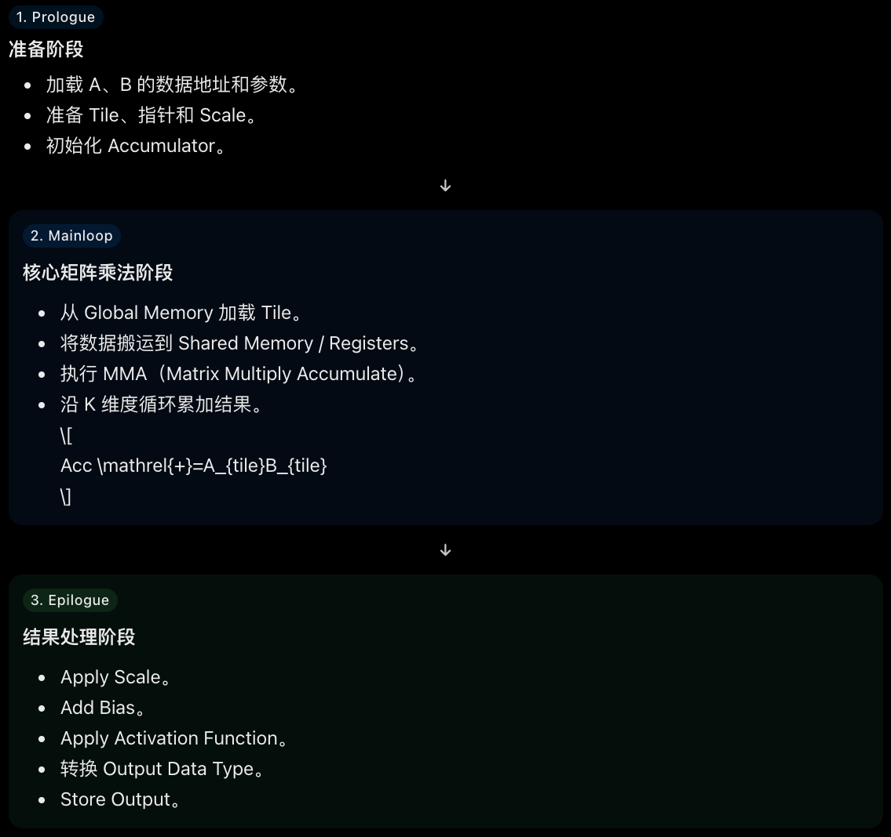

在大模型推理（LLM Inference）中，**GEMM 是 General Matrix Multiplication 的缩写，即通用矩阵乘法**。

它是 GPU 上最核心、最常见的计算操作之一，也是大模型推理过程中最重要的计算负载之一。

## 1. GEMM 到底是什么？

GEMM 本质上就是矩阵乘法，通常表示为：

\\[ C = \alpha AB + \beta C \\]

其中：

- \\(A\\)：矩阵 A，维度为 \\(M \times K\\)
- \\(B\\)：矩阵 B，维度为 \\(K \times N\\)
- \\(C\\)：输出矩阵，维度为 \\(M \times N\\)
- \\(\alpha\\)、\\(\beta\\)：标量系数

如果忽略系数，就是最普通的矩阵乘法：

\\[ C = AB \\]

例如：

\\[ (128 \times 4096) \times (4096 \times 11008) \\]

最终得到一个 \\(128 \times 11008\\) 的矩阵。

## 2. GEMM 在大模型推理中有什么作用？

大模型中的绝大多数 Linear Layer（线性层）都可以转化为 GEMM。

例如，一个 Transformer 中的 FFN（Feed Forward Network）：

\\[ Y = XW_1 \\]\\[ Z = \text{Activation}(Y) \\]\\[ O = ZW_2 \\]

其中：

- \\(X\\)：输入 Hidden States
- \\(W_1, W_2\\)：模型权重
- \\(Y, Z, O\\)：中间计算结果

这里的两次矩阵乘法就是 GEMM。

类似地，Attention 中的 Q、K、V Projection，以及 Attention Output Projection，也都涉及 GEMM。

## 3. GEMM 在 Prefill 和 Decode 阶段有什么区别？

这是大模型推理中非常重要的一个区别。

假设模型的 Hidden Size 是 4096，Batch Size 是 128。

| 阶段          | GEMM 的典型形状                            | 特点                    |
| ----------- | ------------------------------------- | --------------------- |
| Prefill     | \\([128, 4096] \times [4096, 4096]\\) | M 较大，计算密集             |
| Decode      | \\([128, 4096] \times [4096, 4096]\\) | 这里假设 Batch Size 为 128 |
| Decode（单请求） | \\([1, 4096] \times [4096, 4096]\\)   | M 很小，通常更容易受到内存带宽限制    |

注意：这里的 M 对应输入矩阵的行数，通常与参与计算的 Token 数量有关。

- **Prefill**：一次处理大量 Prompt Tokens，通常能够充分利用 GPU 的计算能力。
- **Decode**：每个请求每次通常只生成一个 Token，因此 GEMM 的 M 维度往往较小，权重读取开销相对突出。

这也是为什么大模型推理中，Prefill 和 Decode 往往需要不同的 Kernel 优化策略。

## 4. GEMM 和相关概念的区别

在 GPU Kernel 优化中，你经常会看到以下几个概念：

| 概念          | 含义                                          |
| ----------- | ------------------------------------------- |
| GEMM        | 通用矩阵乘法                                      |
| GEMV        | General Matrix-Vector Multiplication，矩阵向量乘法 |
| GEMM Kernel | 专门执行矩阵乘法的 GPU Kernel                        |
| Tensor Core | GPU 中专门加速矩阵运算的硬件计算单元                        |
| Tiling      | 将大矩阵切分成小块进行计算                               |
| MFMA        | AMD GPU 上的 Matrix Fused Multiply-Add 指令     |
| MMA         | Matrix Multiply-Accumulate，矩阵乘累加操作          |

特别是你在研究 AMD GPU / ROCm / Triton Kernel 时，可能会经常看到 MFMA、GEMM、Tiling 等术语。

**一个值得记住的概念：**

GEMM 通常是计算任务（What），而 GEMM Kernel 是具体的实现方式（How）。

例如，同样一个 GEMM，可以通过不同的 Tile Size、Warp 数量、数据类型（FP16、BF16、FP8 等）和内存访问策略实现，从而产生非常不同的性能。

这也是 GPU Kernel Optimization 的核心工作之一。

---

在 GPU Kernel 优化，尤其是大模型推理中的 GEMM 优化中，**Tiling 和 Split-K 是两种非常重要的优化技术**。

它们解决的问题不太一样：

- **Tiling**：把一个大矩阵乘法拆成多个小矩阵块（Tiles），让 GPU 更高效地执行计算。
- **Split-K**：把矩阵乘法中 K 维度的计算拆成多个部分，让多个 GPU Thread Block 并行计算，增加并行度。

下面结合 GEMM 来解释。

## 1. Tiling：矩阵分块

假设我们有一个 GEMM：

\\[ C\_{M\times N}=A\_{M\times K}\times B\_{K\times N} \\]

如果直接计算整个输出矩阵 C，计算规模可能非常大。

因此，我们将输出矩阵 C 切分成多个小块（Tile），每个 Tile 由一个 GPU Thread Block 负责计算。

例如：

- M = 128
- N = 128
- K = 64
- Tile Size = 32 × 32

那么，输出矩阵 C 就被划分成：

\\[ \frac{128}{32}\times\frac{128}{32}=16 \\]

个 Tile。

每个 Tile 的计算过程可以表示为：

\\[ C\_{tile}=A\_{tile}\times B\_{tile} \\]

实际上，K 维度通常也会进行分块：

\\[ C\_{tile}=\sum\_{k=0}^{K/B_K-1} A\_{tile,k}B\_{k,tile} \\]

这里的 \\(B_K\\) 是 K 维度上的分块大小。

**Tiling 的主要好处：**

1. 提高数据复用率：一个 Tile 加载到 GPU 的寄存器或 Shared Memory 后，可以重复参与计算。
2. 减少 Global Memory 访问：避免反复从显存读取相同数据。
3. 提高并行度：不同 Tile 可以分配给不同的 Thread Block 并行执行。
4. 更好地利用 GPU 的 Tensor Core（NVIDIA）或 MFMA（AMD）。

### Triton 中的 Tiling

例如：

```
@triton.jitdef matmul_kernel(    A, B, C,    M: tl.constexpr,    N: tl.constexpr,    K: tl.constexpr,    BLOCK_M: tl.constexpr,    BLOCK_N: tl.constexpr,    BLOCK_K: tl.constexpr,):    pid_m = tl.program_id(0)    pid_n = tl.program_id(1)    # 当前 Thread Block 负责的输出 Tile    offs_m = pid_m * BLOCK_M + tl.arange(0, BLOCK_M)    offs_n = pid_n * BLOCK_N + tl.arange(0, BLOCK_N)    # 沿 K 维度循环计算    acc = tl.zeros((BLOCK_M, BLOCK_N), dtype=tl.float32)    for k in range(tl.cdiv(K, BLOCK_K)):        # 加载 A、B 的 Tile        # 执行矩阵乘累加        ...    # 写回输出    ...
```

这里：

- `BLOCK_M`：每个 Thread Block 负责的输出 Tile 的 M 维度。
- `BLOCK_N`：每个 Thread Block 负责的输出 Tile 的 N 维度。
- `BLOCK_K`：每次沿 K 维度处理的大小。

这三个参数通常是 GEMM Kernel 调优时最重要的参数之一。

## 2. Split-K：沿 K 维度拆分计算

理解 Split-K，需要先理解 GEMM 的计算方式。

\\[ C\_{M\times N}=A\_{M\times K}\times B\_{K\times N} \\]

对于 C 中的每个元素：

\\[ C\_{i,j}=\sum\_{k=0}^{K-1}A\_{i,k}B\_{k,j} \\]

可以看到，每个输出元素都需要沿 K 维度进行累加。

**Split-K 的核心思想就是：把 K 维度拆成多个部分，让多个 Thread Block 分别计算部分结果，最后再把结果合并。**

例如，假设：

- M = 16
- N = 16
- K = 4096
- Split-K = 4

将 K 维度拆成 4 份，每份 K = 1024。

原本：

\\[ C=A\_{M\times4096}B\_{4096\times N} \\]

拆分后：

\\[ C_0=A_0B_0 \\]\\[ C_1=A_1B_1 \\]\\[ C_2=A_2B_2 \\]\\[ C_3=A_3B_3 \\]

最终：

\\[ C=C_0+C_1+C_2+C_3 \\]

这里每个 \\(C_i\\) 都是一个 \\(M\times N\\) 的部分结果。

### 为什么需要 Split-K？

考虑一个 GEMM：

\\[ M=16,\quad N=16,\quad K=4096 \\]

如果 Tile Size 为 16 × 16，那么整个输出矩阵只有一个 Tile。

也就是说，可能只有一个 Thread Block 在执行计算。

对于拥有大量计算单元的 GPU 来说，这会造成严重的 GPU 利用率不足。

使用 Split-K = 4 后：

- 原本：1 个 Thread Block。
- Split-K 后：4 个 Thread Block。
- 每个 Thread Block 计算一部分 K。
- 最后将 4 个部分结果进行 Reduction。

这样可以增加 GPU 的并行度。

**Split-K 特别适合 M、N 较小，但 K 较大的 GEMM。**

不过，它也有代价：

1. 需要额外的临时存储空间保存部分结果（取决于实现方式）。
2. 需要额外的 Reduction 操作。
3. 增加 Global Memory 读写。
4. 可能引入额外的 Kernel Launch 开销。

因此，Split-K 并不是越大越好。

## 3. Tiling 和 Split-K 的核心区别

| 对比维度   | Tiling            | Split-K                 |
| ------ | ----------------- | ----------------------- |
| 核心思想   | 将矩阵划分成小块          | 将 K 维度拆分成多个部分           |
| 主要目的   | 提高数据复用率和计算效率      | 增加并行度                   |
| 主要划分维度 | M、N，通常也包括 K       | K                       |
| 并行方式   | 不同输出 Tile 并行计算    | 同一个输出 Tile 的不同 K 分段并行计算 |
| 结果合并   | 通常不需要额外 Reduction | 通常需要 Reduction          |
| 典型适用场景 | 大多数 GEMM          | M、N 较小而 K 较大的 GEMM      |

## 4. 两者可以同时使用吗？

(可以，而且很常见)

实际上，Tiling 和 Split-K 并不冲突。

例如：

\\[ M=64,\quad N=128,\quad K=8192 \\]

假设：

- BLOCK_M = 32
- BLOCK_N = 32
- Split-K = 4

那么：

输出矩阵的 Tile 数量：

\\[ \frac{64}{32}\times\frac{128}{32}=8 \\]

每个输出 Tile 再拆分成 4 个 K 分区。

因此，总共可以产生：

\\[ 8\times4=32 \\]

个独立的部分计算任务。

最后再对每个输出 Tile 的 4 个部分结果进行 Reduction。

## 5. 在实际 Kernel Optimization 中怎么选择？

可以记住下面这个经验：

| GEMM 特征                        | 优化方向                            |
| ------------------------------ | ------------------------------- |
| M、N、K 都比较大                     | 优先优化 Tiling、数据复用和计算效率           |
| M、N 较小，K 很大                    | 考虑 Split-K，增加并行度                |
| M 很小（例如 Decode，Batch Size = 1） | 重点关注内存带宽和并行度                    |
| M 较大（例如 Prefill）               | 通常有足够的输出 Tile 并行度，Split-K 未必有帮助 |

对于你研究的 Triton / AMD GPU Kernel，建议重点关注三个参数：

- `BLOCK_M`
- `BLOCK_N`
- `BLOCK_K`

以及 Split-K 对应的分区数量。

**最重要的一点：Tiling 主要解决如何高效地计算，Split-K 主要解决如何让更多 GPU 计算单元参与计算。**

这两个概念是理解 GEMM Kernel 性能优化的基础。

---

在 GPU Kernel 优化中，**GEMM Epilogue（矩阵乘法尾处理阶段）是指 GEMM 的矩阵乘法计算完成之后，对计算结果进行进一步处理的阶段。**

简单来说：

- **Prologue**：GEMM 计算之前的准备工作。
- **Mainloop**：GEMM 的核心矩阵乘法计算过程。
- **Epilogue**：GEMM 计算完成之后，对结果进行处理并写入 Output。

可以把它理解成 GEMM Kernel 的三个阶段。

# **1. GEMM 的三个阶段**

假设我们执行：

\\[ C=A\times B \\]

一个典型的 GPU GEMM Kernel 可以抽象成：



这里最重要的是：Mainloop 负责矩阵乘法本身，Epilogue 负责矩阵乘法之后的结果处理。

# **2. Epilogue 通常包含哪些操作？**

我们以大模型中的 Linear Layer 为例。

一个 Linear Layer 通常可以表示为：

\\[ Y=XW+b \\]

如果后面还跟着一个 Activation Function：

\\[ Y=GELU(XW+b) \\]

那么整个计算可以拆成：

```
GEMM:
    C = X @ W

Epilogue:
    C = C + Bias
    C = GELU(C)

Store:
    Y = C
```

如果不进行算子融合，可能需要：

```
Kernel 1: GEMM
    |
    v
Write C to HBM
    |
    v
Kernel 2: Add Bias
    |
    v
Write C to HBM
    |
    v
Kernel 3: GELU
    |
    v
Write Y to HBM
```

而通过 Epilogue Fusion：

```
Kernel 1: Fused GEMM

    Mainloop:
        C = X @ W

    Epilogue:
        C = C + Bias
        C = GELU(C)

    Store:
        Y = C
```

这样只需要一次 Kernel Launch，并且避免中间 Tensor 的多次读写。

# **3. 为什么 Epilogue 特别适合做算子融合？**

这里涉及一个很重要的 GPU 硬件特点：

**GEMM 的计算结果通常已经保存在 GPU Registers 中的 Accumulator 里。**

例如，假设一个 Thread Block 负责计算一个 \\(128\times128\\) 的 Output Tile：

\\[ C\_{tile}=A\_{tile}\times B\_{tile} \\]

经过 Mainloop 后，计算结果已经存在 Accumulator 中。

这时如果需要：

\\[ Y=sC\_{tile}+b \\]

直接在 Epilogue 中执行：

```
acc = acc * scaleacc = acc + biasoutput = acc.to(output_dtype)
```

就可以直接利用已经存在于 Registers 中的数据。

不需要：

1. 将 GEMM 结果写入 HBM。
2. 再启动一个 Kernel 读取结果。
3. 执行 Scale 和 Bias。
4. 再将结果写回 HBM。

这就是 Epilogue Fusion 的核心价值。

# **4. 联系之前讨论的 Quantization**

现在回到你之前问的量化问题。

假设使用 INT8 Weight-only Quantization：

\\[ W\approx s_WQ_W \\]

那么：

\\[ Y=XW\approx X(s_WQ_W) \\]

根据矩阵乘法的性质：

\\[ Y\approx s_W(XQ_W) \\]

如果 GEMM Mainloop 直接计算：

\\[ Acc=XQ_W \\]

那么 Epilogue 就可以执行：

\\[ Y=s_W\cdot Acc \\]

对应的 Kernel：

```
# Mainloopacc = gemm(x, q_w)# Epilogueacc = acc * weight_scale# Storeoutput = acc.to(output_dtype)
```

如果还有 Bias：

```
# Epilogueacc = acc * weight_scaleacc = acc + biasoutput = acc.to(output_dtype)
```

这样，Dequantization、Bias Addition 和类型转换都可以融合到 GEMM 的 Epilogue 中。

需要注意：如果使用的是 INT8 GEMM，Accumulator 通常是 INT32；如果使用 FP16/FP8 GEMM，Accumulator 类型则取决于具体硬件指令和 Kernel 实现。

# **5. 在 Triton / CUDA Kernel 中如何理解 Epilogue？**

如果你在阅读 Triton、CUDA 或 CUTLASS 的 GEMM 实现，可以重点关注下面这些概念：

| 概念          | 含义                    |
| ----------- | --------------------- |
| Prologue    | GEMM 前的准备             |
| Mainloop    | 核心矩阵乘法循环              |
| Accumulator | 保存矩阵乘法累加结果            |
| Epilogue    | 对 Accumulator 进行后处理   |
| Store       | 将最终结果写回 Global Memory |

例如 CUTLASS 中，经常可以看到 Epilogue Visitor、Epilogue Fusion 等概念，它们就是用于组织和融合 GEMM 后处理操作的机制。

## **6. 一个值得记住的性能优化原则**

**尽可能在数据还留在 Registers 中时完成后处理。**

推荐

GEMM → Epilogue Fusion → Store

不理想

GEMM → Store → 新 Kernel → Load → 后处理 → Store

当然，并不是所有操作都适合 Epilogue Fusion。例如需要跨 Thread Block 的全局 Reduction，通常无法直接在普通 GEMM Epilogue 中完成。

**你可以把 Epilogue 理解成 GPU GEMM Kernel 中一个非常重要的融合窗口：凡是能够在不破坏数据依赖和并行执行条件的前提下，对 Accumulator 进行的后处理，都值得考虑放进 Epilogue。**

---

在 GPU GEMM（矩阵乘法）中，**Accumulator（累加器）是用于保存矩阵乘法中间累加结果的存储单元。**

简单来说，GEMM 并不是一次性完成整个矩阵乘法，而是将 K 维度拆分成多个 Tile，逐步计算乘积并累加。Accumulator 就是用来保存这些逐步累加结果的。

它通常位于 GPU 的 Registers 中，具体布局取决于 GPU 架构和 Kernel 实现。

## **1. 为什么需要 Accumulator？**

先看 GEMM 的基本公式：

\\[ C=A\times B \\]

假设：

\\[ A\in R^{M\times K},\quad B\in R^{K\times N} \\]

那么输出矩阵中的一个元素为：

\\[ C\_{ij}=\sum\_{k=0}^{K-1}A\_{ik}B\_{kj} \\]

例如：

\\[ C\_{ij}=A\_{i0}B\_{0j}+A\_{i1}B\_{1j}+\cdots+A\_{i3}B\_{3j} \\]

如果 K=4，计算过程可以拆成：

```
Step 1:
acc = 0

Step 2:
acc += A[i, 0] * B[0, j]

Step 3:
acc += A[i, 1] * B[1, j]

Step 4:
acc += A[i, 2] * B[2, j]

Step 5:
acc += A[i, 3] * B[3, j]

Final:
C[i, j] = acc
```

这里的 `acc` 就是 Accumulator。

它不断保存当前的部分计算结果，直到 K 维度上的所有乘积都累加完成。

## **2. 在 GPU GEMM 中，Accumulator 是如何工作的？**

实际 GPU GEMM 通常采用 Tiling（分块计算）。

例如：

\\[ C\_{tile}=A\_{tile}\times B\_{tile} \\]

假设：

- M = 4096
- N = 4096
- K = 4096
- Block Tile = 128 × 128
- K Tile = 32

那么每个 Thread Block 负责计算一个 \\(128\times128\\) 的输出 Tile。

由于 K=4096，每次只处理 K 维度上的 32 个元素，因此需要：

\\[ 4096/32=128 \\]

次迭代。

计算过程如下：

**Accumulator 的更新过程**

**初始化 Accumulator**

\\[ Acc=0 \\]

**K Tile Iteration 1**

加载 A 和 B 的当前 Tile，执行 MMA

\\[ Acc\mathrel{+}=A\_{tile}B\_{tile} \\]

**K Tile Iteration 2**

加载 A 和 B 的当前 Tile，执行 MMA

\\[ Acc\mathrel{+}=A\_{tile}B\_{tile} \\]

**K Tile Iteration 3**

加载 A 和 B 的当前 Tile，执行 MMA

\\[ Acc\mathrel{+}=A\_{tile}B\_{tile} \\]

**K Tile Iteration 4**

加载 A 和 B 的当前 Tile，执行 MMA

\\[ Acc\mathrel{+}=A\_{tile}B\_{tile} \\]

……实际示意中省略了中间迭代

**最终 Accumulator**

\\[ Acc=\sum\_{k=0}^{127}A_kB_k \\]

完成所有 K Tile 的累加

**Epilogue → Store Output**

注意：上面只画了 4 次迭代作为示意，实际需要 128 次。

## **3. Accumulator 使用什么数据类型？**

这是理解低精度 GEMM 非常重要的一点。

**输入数据类型和 Accumulator 数据类型不一定相同。**

GPU 通常会使用比输入数据精度更高的类型进行累加，以避免数值误差过大。

常见组合：

| GEMM 输入类型 | 常见 Accumulator 类型        |
| --------- | ------------------------ |
| FP16      | FP32 或 FP16，取决于计算路径      |
| BF16      | FP32                     |
| FP8       | FP32                     |
| INT8      | INT32                    |
| INT4      | INT32（常见整数计算路径）          |
| FP4       | 通常使用 FP32 或硬件支持的更高精度累加路径 |

例如 INT8 GEMM：

\\[ A\_{int8}\times B\_{int8} \\]

两个 INT8 数相乘，乘积可以使用更宽的整数表示。

因此，通常采用 INT32 进行累加：

\\[ Acc\_{int32}=\sum_k A\_{int8,k}B\_{int8,k} \\]

最终再通过 Scale 将结果转换成 FP16/BF16 等输出类型。

## **4. Accumulator 和 Register、Shared Memory 有什么关系？**

这是从 GPU 硬件架构理解 GEMM 的关键。

首先区分三个概念：

- **Accumulator**：一个逻辑概念，表示保存累加结果的数据。
- **Register**：GPU 上的高速存储资源。
- **Shared Memory**：Thread Block 内多个线程可以共享的片上存储空间。

在典型的高性能 GEMM Kernel 中：

| 数据                     | 常见存储位置                    |
| ---------------------- | ------------------------- |
| A、B 的 Global Memory 数据 | HBM                       |
| A、B 的 Tile             | Shared Memory / Registers |
| MMA 的部分计算结果            | Accumulator Registers     |
| 最终输出 C                 | Registers → Global Memory |

[Advanced Matrix Multiplication Optimization on NVIDIA GPUs](https://images.openai.com/static-rsc-4/g6YqGjcQSEGSMSz0enzh4Jbc11JHWNi2Y0EgNSd2wGcinX2ZiEoPzKZQcOHt6ONnf9roldmFCjGIw9s0jLrWiDJY3YaVpW9Ny2BARENSGdF6zAF5Ad44-X4yDyMLbhHkHKC0Qdgog9Co8-jXSPejB6AjON5YovTLIxN6Tuw-yBY?purpose=inline)

[salykova.github.io](https://salykova.github.io/sgemm-gpu?utm_source=chatgpt.com)

特别注意：

**Accumulator 并不是一种独立于 Register 的物理内存层级。**

在 NVIDIA GPU 上，Tensor Core 的 MMA 指令可以将累加结果保存在寄存器中。例如 CUDA PTX 中的 `mma.sync` 指令就有明确的 accumulator 操作数。

AMD GPU 上也有类似的累加机制，例如 MFMA 指令使用 VGPR 保存累加结果。

## **5. 为什么 Accumulator 会影响 GEMM Kernel 性能？**

这里就联系到之前讨论过的 Register Pressure 和 Register Spilling。

假设一个 Thread Block 计算：

\\[ C\_{tile}\in R^{128\times128} \\]

那么需要保存：

\\[ 128\times128=16384 \\]

个输出元素的累加结果。

这些结果需要分布到 Thread Block 内的多个线程上。

如果 Accumulator 占用了太多 Registers，就可能产生：

1. Register Pressure 增大。
2. 每个 SM 能同时驻留的 Thread Block 数量减少。
3. Occupancy 降低。
4. 甚至发生 Register Spilling。

这也是为什么 GEMM Kernel 的 Tile Size 不能无限增大。

更大的 Tile 虽然可能提高数据复用率，但也会增加 Accumulator 的存储需求。

## **6. 联系 GEMM Epilogue：为什么 Accumulator 如此重要？**

还记得之前讨论的 Epilogue 吗？

现在可以把它们串起来了。

假设计算：

\\[ Y=s(XQ_W)+b \\]

其中：

- \\(Q_W\\)：量化后的 INT8 Weight。
- \\(s\\)：Weight Scale。
- \\(b\\)：Bias。

整个 GEMM Kernel 可以这样实现：

```
# 1. Initialize Accumulatoracc = 0# 2. GEMM Mainloopfor k_tile in range(num_k_tiles):    a = load_activation(...)    b = load_quantized_weight(...)    acc += mma(a, b)# 3. GEMM Epilogueacc = acc * weight_scaleacc = acc + bias# 4. Convert and Storeoutput = acc.to(fp16)store(output)
```

这里最关键的是：

**Mainloop 结束后，GEMM 的计算结果仍然保存在 Accumulator 中，因此可以直接在 Epilogue 中执行 Scale、Bias、Activation 等操作，最后再写入 HBM。**

这就是为什么 Accumulator 是 GEMM Epilogue Fusion 的基础之一。

## **7. 总结一下这几个概念的关系**

| 概念          | 作用                         |
| ----------- | -------------------------- |
| GEMM        | 执行矩阵乘法                     |
| Tiling      | 将大矩阵拆成小块计算                 |
| MMA / MFMA  | GPU 上执行矩阵乘累加的硬件指令          |
| Accumulator | 保存矩阵乘法的累加结果                |
| Register    | 通常用于存储 Accumulator 的高速存储资源 |
| Epilogue    | 对最终 Accumulator 进行后处理      |

**建议你接下来重点理解 NVIDIA 的&#x20;**`mma.sync`**&#x20;/&#x20;**`wgmma`**&#x20;和 AMD 的&#x20;**`mfma`**&#x20;指令。** 它们能帮助你真正理解 GPU 是如何执行矩阵乘法、如何更新 Accumulator，以及为什么不同架构的 GEMM Kernel 会有不同的性能特征。
