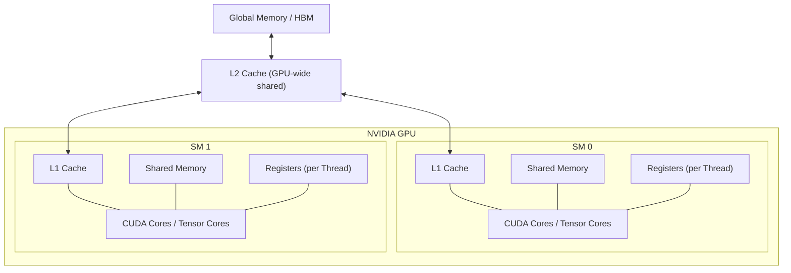
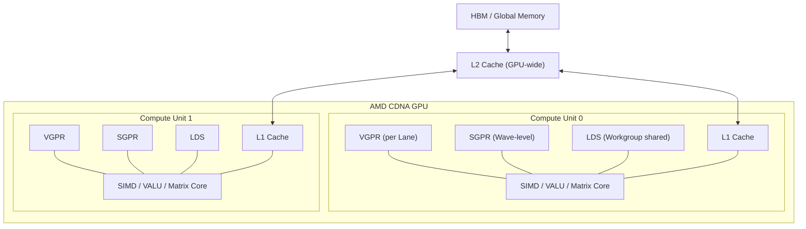
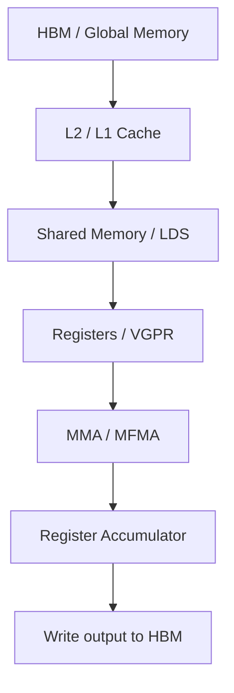

在 GPU Kernel Optimization 中，理解 GPU Memory Architecture（内存架构）非常重要。

尤其是你现在研究的 **Triton、ROCm、AMD GPU、GEMM 和 Attention Kernel**，很多性能问题实际上都与数据在不同内存层级之间如何移动有关。

例如：

- 为什么 Register 比 LDS / Shared Memory 快？
- 为什么 Global Memory Access 的延迟很高？
- 为什么 Tiling 可以提高性能？
- 为什么需要 Memory Coalescing？
- 为什么会出现 Bank Conflict？
- 为什么增加 Register Usage 可能降低 Occupancy？

这些问题都可以从 GPU 的内存架构中找到答案。

下面我分别介绍 NVIDIA 和 AMD GPU 的内存层级，再比较两者的区别。

# 1. GPU 内存架构总览

先看一个简化的 GPU Memory Hierarchy。

GPU 的内存体系可以大致分为以下几个层级：

| 层级 | NVIDIA        | AMD         | 主要特点             |
| -- | ------------- | ----------- | ---------------- |
| 1  | Registers     | VGPR / SGPR | 最快，Thread 私有     |
| 2  | Shared Memory | LDS         | 片上高速存储，线程块内共享    |
| 3  | L1 Cache      | L1 Cache    | 片上缓存，靠近计算单元      |
| 4  | L2 Cache      | L2 Cache    | GPU 多个计算单元共享的缓存  |
| 5  | HBM / GDDR    | HBM / GDDR  | GPU 外部主存，容量大、带宽高 |

这里需要注意：

**这并不是一个严格的串行访问路径。**

例如，Shared Memory / LDS 是显式管理的存储空间，而 L1 / L2 Cache 通常由硬件管理。实际访问路径取决于指令、缓存策略和具体架构。

另外，Register、Shared Memory、L1 Cache、L2 Cache 和 HBM 并不是简单地依次经过的五级流水线。

# 2. 各层内存的特点

## 2.1 Registers：寄存器

(速度最快)

Registers 是 GPU 计算单元直接使用的存储资源。

NVIDIA 和 AMD 的叫法：

- NVIDIA：Registers
- AMD：VGPR（Vector General Purpose Register）、SGPR（Scalar General Purpose Register）

主要特点：

1. 每个 Thread / GPU Lane 使用自己的寄存器。
2. 访问延迟非常低。
3. 容量有限。
4. 寄存器资源由一个 SM / CU 内的多个并发执行线程共享分配。

例如 GEMM：

\\[ C\_{tile}=A\_{tile}\times B\_{tile} \\]

在执行矩阵乘法时，Accumulator 通常会保存在寄存器中：

```
acc = tl.zeros(    (BLOCK_M, BLOCK_N),    dtype=tl.float32)
```

这个 `acc` 是一个逻辑上的 Triton Tensor，编译后会分布到各个 Thread 的寄存器中。

**为什么 Register 很重要？**

因为 GPU 的计算单元需要频繁读取操作数和写入中间结果。如果这些数据可以保存在寄存器中，就不需要反复访问更低层级的存储。

不过，寄存器不是越多越好：

- Register Usage 太高，可能降低 Occupancy。
- 超出可分配的寄存器资源，可能出现 Register Spilling。
- Spilling 通常会导致额外的 Local Memory 访问。

## 2.2 Shared Memory / LDS：共享内存

(高速片上存储)

这是 GPU Kernel 优化中非常重要的一层。

NVIDIA 称为 Shared Memory，AMD 称为 LDS（Local Data Share）。

主要特点：

1. 位于 GPU 芯片内部。
2. 一个 Thread Block（NVIDIA）或 Workgroup（AMD）中的线程可以共享访问。
3. 通常由程序员显式管理。
4. 容量比 Registers 大，但访问速度通常比 Registers 慢。
5. 被划分为多个 Memory Banks，因此可能发生 Bank Conflict。

例如 GEMM 中：

```
Global Memory
     |
     v
Load A Tile / B Tile
     |
     v
Shared Memory / LDS
     |
     v
Load operands
     |
     v
MFMA / MMA
     |
     v
Register Accumulator
```

为什么需要 Shared Memory / LDS？

假设一个 GEMM Tile 需要反复使用 A 和 B 的数据。

如果每次计算都从 Global Memory 读取，就会产生大量重复访存。

可以先将 A、B 的 Tile 加载到 Shared Memory / LDS，然后让多个 Thread 复用这些数据。

这就是 Tiling 和 Data Reuse 的核心思想。

另外，Shared Memory / LDS 通常还可以与 Global Memory Load 配合，实现 Double Buffering：

- Buffer 0：当前正在计算。
- Buffer 1：提前加载下一批数据。

从而尽量隐藏 Global Memory 的访问延迟。

## 2.3 L1 Cache：一级缓存

L1 Cache 是靠近 GPU 计算单元的高速缓存。

主要特点：

1. 通常位于 SM / CU 附近。
2. 由硬件自动管理。
3. 缓存最近访问过的数据。
4. 可以减少重复访问 L2 / HBM 的开销。
5. 容量有限。

需要特别注意 NVIDIA 和 AMD 的区别：

- NVIDIA 某些架构允许 Shared Memory 和 L1 Cache 共享一部分片上存储资源。
- AMD 的具体 L1 Cache 组织方式、容量和 LDS 的关系取决于 GPU 架构。

L1 Cache 并不是所有 Global Memory Load 都必然经过的地方，具体取决于缓存策略和指令。

## 2.4 L2 Cache：二级缓存

L2 Cache 是 GPU 内多个计算单元共享的重要缓存层级。

主要特点：

1. 通常是整个 GPU 共享的缓存。
2. 容量大于单个计算单元附近的 L1 Cache。
3. 访问速度通常比 HBM 快。
4. 可以减少 HBM 访问。
5. 对多个 Kernel、多个 SM / CU 之间的数据复用很重要。

例如：

假设一个模型的权重数据被多个 GPU Compute Unit 访问。

第一次访问时，数据可能需要从 HBM 加载到 L2 Cache。

后续访问如果命中 L2，就不需要再次从 HBM 读取。

这对于大模型推理尤其重要。

不过，如果模型权重远大于 L2 Cache，不能假设权重会一直留在 L2 中。

## 2.5 HBM / GDDR：显存

(容量最大，带宽高)

这是 GPU 最主要的外部存储空间。

NVIDIA 和 AMD 都使用 HBM 或 GDDR 等显存技术，具体取决于产品。

主要特点：

1. 容量远大于片上存储。
2. 带宽非常高。
3. 访问延迟远高于 Register 和片上存储。
4. 存放模型权重、KV Cache、输入输出 Tensor 等。

例如，一个 LLM 推理服务中：

- Model Weights 通常存储在 GPU HBM。
- KV Cache 通常存储在 GPU HBM。
- Activation Tensor 也可能存储在 HBM。
- Kernel 执行过程中需要将数据从 HBM 加载到计算单元附近。

对于大模型 Decode 阶段，读取模型权重往往是非常重要的内存开销。

这也是为什么 Decode 经常表现出 Memory-bound 的特征。

# 3. NVIDIA GPU 内存架构

NVIDIA GPU 的基本计算单元是 SM（Streaming Multiprocessor）。

一个 GPU 通常包含很多 SM，每个 SM 内部有自己的寄存器文件、Shared Memory 和 L1 Cache，并通过 L2 Cache 连接到外部显存。

可以把 NVIDIA 的架构抽象成下面这样：



注意，这是一张逻辑结构图，不代表所有数据访问都必须依次经过 L1、L2。实际缓存路径取决于访问指令和缓存策略。

### NVIDIA 各层级的作用域

| 存储            | 所属范围           | 可见范围            |
| ------------- | -------------- | --------------- |
| Register      | Thread         | 当前 Thread       |
| Shared Memory | SM 上的 Block 资源 | 当前 Thread Block |
| L1 Cache      | SM             | SM 内执行的线程       |
| L2 Cache      | 整个 GPU         | 所有 SM           |
| Global Memory | GPU 显存         | 所有 SM           |

有两个值得注意的地方：

**第一，Shared Memory 和 L1 Cache 在一些 NVIDIA 架构中共享物理存储资源。**

例如，在 Ampere 架构中，SM 内部存在 Unified Data Cache，可以根据配置分配给 L1 Cache 和 Shared Memory 使用。

**第二，NVIDIA 的 Local Memory 不是 Shared Memory。**

这是一个很容易混淆的概念：

- Shared Memory：片上高速共享存储。
- Local Memory：Thread 私有的逻辑地址空间，实际通常位于设备内存，并由缓存层级服务。

因此，Register Spilling 通常会导致 Local Memory 访问，而不是自动转移到 Shared Memory。

# 4. AMD GPU 内存架构

AMD GPU 的基本计算单元在 CDNA 架构中称为 CU（Compute Unit）。

AMD CDNA 架构中的 CU 包含：

- VGPR：Vector General Purpose Register
- SGPR：Scalar General Purpose Register
- LDS：Local Data Share
- L1 Cache
- SIMD / VALU / Matrix Core 等计算单元

多个 CU 通过片上互连访问共享的 L2 Cache，最终连接 HBM。

AMD 的内存架构可以抽象为：



这同样是概念图，不是所有 AMD GPU 都完全相同的物理布局。

### AMD 特有的几个概念

**1. VGPR**

VGPR 是 Vector General Purpose Register。

主要保存每个 Lane 各自的数据，例如：

- 向量运算操作数。
- 中间计算结果。
- 部分 GEMM Accumulator 数据。

例如，AMD Wavefront 中的不同 Lane 可以在同一条向量指令下操作各自的 VGPR 数据。

**2. SGPR**

SGPR 是 Scalar General Purpose Register。

主要保存 Wavefront 中共享的标量信息，例如：

- 地址和指针。
- 循环控制变量。
- 标量参数。
- 部分控制信息。

一个容易记忆的区别：

- VGPR：通常每个 Lane 有自己的值。
- SGPR：通常由整个 Wavefront 共享一个标量值。

**3. LDS**

LDS 是 AMD 非常重要的片上存储资源。

它的作用类似 NVIDIA Shared Memory：

- Workgroup 内多个 Work-item 可以共享。
- 可以缓存 Global Memory 中的数据。
- 可以用于 Thread / Wavefront 之间的数据交换。
- 存在 Bank Conflict 问题。

例如，AMD CDNA 4 的 ISA 文档描述了每个 CU 具有 160 KB LDS，分成 64 个 Bank，每个 Bank 的访问组织也有明确规定。

这里要注意：这个容量是 CDNA 4 的具体架构参数，不应该直接套用到 MI200、MI300 或其他 GPU。

**4. L2 Cache**

AMD GPU 的 L2 Cache 是多个 CU 共享的重要缓存层级。

在 CDNA 架构中，L2 还承担重要的缓存一致性和内存访问协调职责。

# 5. NVIDIA 和 AMD 内存架构对比

把两者放在一起看：

| 层级         | NVIDIA        | AMD        | 对应关系      |
| ---------- | ------------- | ---------- | --------- |
| 寄存器（向量）    | Registers     | VGPR       | 基本对应      |
| 寄存器（标量）    | Registers     | SGPR       | AMD 有明确区分 |
| 片上共享内存     | Shared Memory | LDS        | 基本对应      |
| 一级缓存       | L1 Cache      | L1 Cache   | 基本对应      |
| 二级缓存       | L2 Cache      | L2 Cache   | 基本对应      |
| 外部显存       | HBM / GDDR    | HBM / GDDR | 基本对应      |
| Thread 执行组 | Warp          | Wavefront  | 执行模型不同    |
| 计算单元       | SM            | CU         | 组织结构不同    |

需要注意，二者只是编程概念和功能上的对应，并不意味着硬件实现完全相同。

例如：

- NVIDIA 的 Warp 通常是 32 个 Thread。
- AMD CDNA 的 Wavefront 通常是 64 个 Lane。
- AMD 新一些的架构也支持 Wave32 执行模式。
- LDS 和 Shared Memory 的 Bank 数量、访问规则也可能不同。

# 6. 数据在不同内存层级之间如何流动？

现在结合一个实际的 GEMM Kernel 看看。

假设：

\\[ C=AB \\]

其中 A、B 是 HBM 中的输入矩阵。

我们希望计算：

\\[ C\_{tile}=A\_{tile}\times B\_{tile} \\]

一个典型的 GEMM 数据流如下：

可以简化成：



这里展示的是一种典型的分层数据复用方式，并不是所有 Kernel 都必须经过每一层。

例如：

- 有些 Kernel 直接从 Global Memory 加载到寄存器。
- 有些 Kernel 使用异步 Global-to-LDS 数据搬运。
- 有些 Kernel 使用 Register Tiling。
- 有些 Kernel 完全不需要 LDS。

### 为什么需要这样的数据流？

假设一个 GEMM 的 Tile Size 是：

```
BLOCK_M = 64BLOCK_N = 64BLOCK_K = 32
```

每次计算：

1. 从 HBM / Cache 加载 A、B 的 Tile。
2. 将数据放入 LDS（或通过其他数据搬运路径）。
3. 将计算所需的数据分配到 VGPR / Register。
4. 执行 MFMA / MMA。
5. 将计算结果保存在 Register Accumulator 中。
6. K 维度循环结束后，将结果写回 Global Memory。

核心思想是：

**尽量让数据在靠近计算单元的位置被重复使用，而不是每次计算都重新访问 HBM。**

这正是 Tiling、Data Reuse 和 Double Buffering 的价值。

# 7. 不同内存层级的性能特点

这里给出一个定性的比较：

| 内存层级                | 容量 | 延迟  | 主要用途              |
| ------------------- | -- | --- | ----------------- |
| Register            | 极小 | 极低  | 保存计算操作数和中间结果      |
| LDS / Shared Memory | 小  | 低   | 数据复用、线程间通信        |
| L1 Cache            | 小  | 低   | 缓存局部访问数据          |
| L2 Cache            | 中等 | 中等  | 缓存 GPU 共享数据       |
| HBM                 | 大  | 相对高 | 存储模型权重、KV Cache 等 |

这里不列具体延迟数字，是因为它们高度依赖 GPU 架构、访问模式、指令和 Cache 命中情况。

另外，还有一个非常重要的概念：

**速度（Latency）和带宽（Bandwidth）不是一回事。**

- Latency：发起一次访问后，需要等待多久才能拿到数据。
- Bandwidth：单位时间内能够传输多少数据。

例如，HBM 虽然访问延迟相对较高，但具有非常高的带宽。

这也是 GPU 能够高效处理大规模矩阵运算的重要原因。

# 8. 和大模型推理中的性能优化有什么关系？

最后，把这些概念与你研究的大模型推理联系起来。

| 优化技术                           | 主要利用的内存层级                       | 优化目标                 |
| ------------------------------ | ------------------------------- | -------------------- |
| Tiling                         | LDS / Shared Memory + Registers | 提高数据复用率              |
| Register Tiling                | Registers / VGPR                | 减少重复访存               |
| Memory Coalescing              | Global Memory / HBM             | 减少内存事务               |
| Bank Conflict Optimization     | LDS / Shared Memory             | 减少 Bank 冲突           |
| Double Buffering               | LDS / Shared Memory             | 隐藏数据搬运延迟             |
| Register Spilling Optimization | Registers / VGPR                | 避免额外 Local Memory 访问 |
| Cache Optimization             | L1 / L2                         | 提高 Cache Hit Rate    |

尤其是大模型推理：

**Prefill 阶段：**

- GEMM 规模通常比较大。
- Tiling 和数据复用非常重要。
- 需要充分利用 MFMA / Tensor Core。
- 要平衡计算吞吐量和内存带宽。

**Decode 阶段：**

- Batch Size 较小时，GEMM 的 M 维度通常较小。
- 模型权重读取可能成为主要瓶颈。
- HBM Bandwidth、L2 Cache 和 Memory Coalescing 非常重要。
- 还需要考虑 KV Cache 的访问效率。

---

# 9. 建议你建立的知识体系

如果你想系统掌握 GPU Kernel Optimization，我建议按照下面的顺序学习：

**GPU Memory Architecture 学习路线**

1. **Memory Hierarchy**

   Register、LDS / Shared Memory、L1、L2、HBM
2. **Memory Access Pattern**

   Coalescing、Stride、Alignment、Bank Conflict
3. **Data Reuse**

   Tiling、Register Tiling、Double Buffering
4. **Resource Management**

   Register Pressure、Spilling、Occupancy
5. **Performance Analysis**

   Roofline Model、Effective Bandwidth、Compute Throughput

**我特别建议你下一步深入理解 LDS / Shared Memory 和 VGPR / Register 之间的关系。**

因为在 AMD Triton GEMM Kernel 中，数据如何从 Global Memory 搬运到 LDS，再从 LDS 分发到 VGPR，最后进入 MFMA，是理解高性能 GEMM Kernel 实现的关键。

官方资料也值得收藏：

- NVIDIA CUDA Programming Guide — Memory Hierarchy
- AMD HIP — Hardware Implementation
- AMD CDNA4 ISA Reference Guide

这些资料可以帮助你从架构层面理解 Triton Kernel 最终生成的 GPU 指令和数据访问行为。
