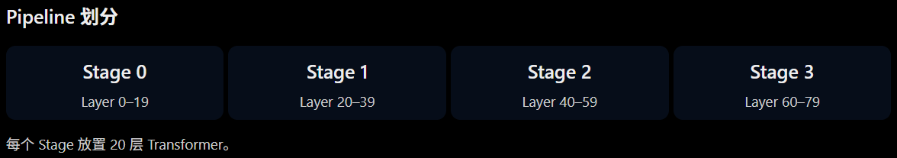
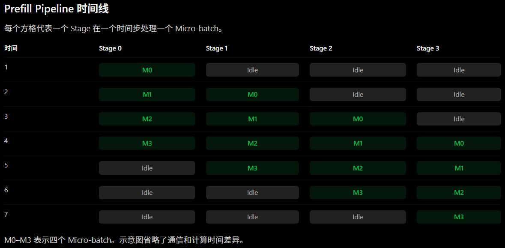
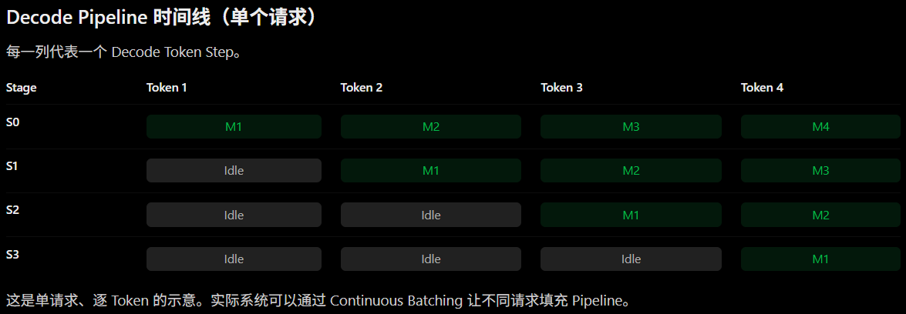

**Q：在大模型推理中，为什么 PP 更适合用于 prefill，而不适合用于 decode？**

在大模型推理（LLM Inference）中，Pipeline Parallelism（PP，流水线并行）通常更适合 Prefill 阶段，而不太适合 Decode 阶段，核心原因是：

Prefill 阶段具有较大的计算量和较高的计算并行度，容易填满 Pipeline；而 Decode 阶段每次只处理一个或少量 Token，计算量较小，Pipeline 很容易出现大量 Bubble（空闲时间）。

我们从计算特征、Pipeline 利用率和硬件效率三个方面理解。
1. Prefill 和 Decode 的计算特征不同
先看两个阶段的区别：
特征	Prefill	Decode
输入 Token 数量	通常较多	每次通常 1 个 Token
Batch 中的计算量	大	相对较小
GEMM 形态	大 M 维度	小 M 维度
GPU 利用率	通常较高	通常较低
主要瓶颈	Compute-bound 或 Memory-bound	通常 Memory-bound
并行计算机会	多	相对少

假设有一个 Transformer 模型：
- 80 层 Transformer。
- Hidden Size = 8192。
- Prefill 输入长度 = 4096 Tokens。
- Decode 每次生成 1 个 Token。
在 Prefill 阶段，模型需要处理 4096 个 Token。

例如，某个 Linear 层的计算可以表示为：
\[
Y_{4096\times 8192}
=
X_{4096\times 8192}
W_{8192\times 8192}
\]

这是一个较大的 GEMM，M 维度为 4096，能够充分利用 GPU 上的计算资源。

而在 Decode 阶段：
\[
Y_{1\times 8192}
=
X_{1\times 8192}
W_{8192\times 8192}
\]

M 维度变成了 1。

这时 GEMM 的计算并行度大幅下降，通常无法充分利用 GPU 的计算能力。
2. 为什么 Prefill 更适合 Pipeline Parallelism？
假设我们把 80 层 Transformer 分成 4 个 Pipeline Stage：

Pipeline Parallelism 的核心思想是：将一个 Batch 拆分成多个 Micro-batch，让不同 Stage 同时处理不同的 Micro-batch。
Prefill 阶段
假设将 4096 个 Token 拆成 4 个 Micro-batch，每个包含 1024 个 Token。

Pipeline 执行过程如下：

可以看到：

- Pipeline 初始阶段需要逐步填满。
- 中间阶段，4 个 GPU Stage 可以同时工作。
- 最后阶段，Pipeline 逐步排空。
因为每个 Micro-batch 包含 1024 个 Token，计算量足够大，每个 Stage 都有较多工作可以执行。

因此，虽然存在 Pipeline Bubble，但相对于整体计算时间，Bubble 的占比可能比较低。
Decode 阶段
现在假设 Decode 每次只生成一个 Token。

同样使用 4 个 Pipeline Stage。

每个 Decode Step 都必须经历：

1. Stage 0 计算当前 Token 的前 20 层。
2. 将 Hidden States 传输给 Stage 1。
3. Stage 1 计算接下来的 20 层。
4. 继续传递给 Stage 2、Stage 3。
5. 最终得到下一个 Token。

问题在于：

- 每个 Token 的计算量很小。
- 每个 Stage 需要等待上一个 Stage 的结果。
- Stage 之间需要进行通信。
- GPU 可能还没来得及充分利用计算资源，就已经完成当前 Token 的计算。
因此，Pipeline 通信、调度和同步的开销可能占据很大比例。

更重要的是，Decode 有严格的自回归依赖：
\[
Token_{t+1}=f(Token_1,\ldots,Token_t)
\]

也就是说，同一个请求的下一个 Token 必须等待当前 Token 生成完成。

这使得单请求的 Decode Pipeline 难以获得足够的并行度。
1. Pipeline Bubble 是关键问题
我们可以用一个简单的公式理解 Pipeline 的效率。

假设：
- Pipeline Stage 数量为 \(P\)。
- Micro-batch 数量为 \(M\)。
- 每个 Stage 的计算时间相同，均为 \(T\)。
理想情况下，Pipeline 的总执行时间为：
\[
T_{pipeline}=(P+M-1)T
\]

而完全没有 Pipeline 空闲时的理想执行时间为：
\[
T_{ideal}=MT
\]

所以 Pipeline Utilization 为：
\[
U=\frac{MT}{(P+M-1)T}
=\frac{M}{P+M-1}
\]

假设有 4 个 Pipeline Stage：
Micro-batch 数量	Pipeline 利用率
1	25%
2	40%
4	57.1%
8	72.7%
16	84.2%
32	91.4%

这说明：

Pipeline Parallelism 要想获得较高的利用率，需要足够多的 Micro-batch。

Prefill 可以比较自然地把大量 Token 拆成多个 Micro-batch。

而 Decode 如果只考虑单个请求，每次只有一个 Token，Micro-batch 数量就很难增加。

当然，实际的 Decode 可以利用 Continuous Batching，把多个请求的 Token 放在同一个 Batch 中执行，但这会引出其他问题。
1. 为什么 Decode 不直接使用更大的 Batch？
你可能会问：

既然 Pipeline Utilization 取决于 Micro-batch 数量，那 Decode 阶段也可以把很多请求放进 Batch，不就能解决问题了吗？

这是一个非常好的问题。

实际上，工业级 LLM Serving 确实会通过 Continuous Batching 提高 Decode 的 Batch Size。

但 Decode 仍然有几个限制：

① Decode 的主要瓶颈通常是 Memory Bandwidth

Decode 阶段通常需要反复读取模型权重。

当 Batch Size 很小时，计算量相对于权重读取量很低。

增大 Batch Size 可以让多个请求共享一次权重读取，从而提高计算效率。

但如果已经达到较高的 Batch Size，继续增加 Batch Size 可能受到显存容量、KV Cache 和延迟约束。

② Pipeline 增加了 Token Generation Latency

对于一个请求而言，假设模型被分成 4 个 Stage，那么一个 Token 需要依次经过 4 个 Stage。

每个 Token 都需要经过完整的 Pipeline。

这会引入 Stage 间的通信和同步开销。

特别是当每个 Stage 的计算量较小时，这些额外开销可能非常明显。

③ Decode 对 Token Latency 非常敏感

Prefill 主要影响 Time To First Token（TTFT）。

Decode 主要影响 Inter-Token Latency（ITL）。

Decode 每一步都需要尽可能快地生成下一个 Token。

如果 Pipeline 通信、调度和同步增加了单 Token 的延迟，就可能直接影响用户体验。
5. 那么为什么有些系统仍然在 Decode 使用 PP？
这里需要补充一个重要的 nuance：

PP 并不是不能用于 Decode，而是它通常不是优化 Decode 吞吐和延迟的首选方式。

例如：
- 当模型非常大，单张 GPU 无法容纳足够多的模型层时，PP 仍然是必要的。
- 当请求并发量很高时，可以利用多个请求形成足够大的 Micro-batch。
- 当模型跨节点部署时，可以结合 PP 和其他并行策略进行资源管理。
实际上，LLM Serving 中经常采用不同的并行策略组合：
并行策略	Prefill	Decode
TP (Tensor Parallelism)	常用	常用
PP (Pipeline Parallelism)	比较适合	有条件地使用
DP (Data Parallelism)	常用	常用
EP (Expert Parallelism)	MoE 模型常用	MoE 模型常用

还有一个值得了解的方向：Disaggregated Prefill/Decode。

它将 Prefill 和 Decode 放在不同的 GPU 实例或 GPU 集群上运行：

这样可以针对两个阶段不同的计算特征，分别选择合适的并行策略：
- Prefill 集群：更注重计算吞吐量，可以使用较大的计算 Batch 和 PP。
- Decode 集群：更注重 Memory Bandwidth、KV Cache 管理和低 ITL，可以使用 TP、DP 等策略。

1. 总结：记住这三个核心原因
2. 计算粒度不同：Prefill 有大量 Token，GEMM 的 M 维度大；Decode 每次通常只有一个 Token，计算粒度小。
3. Pipeline 利用率不同：Prefill 容易构造足够多的 Micro-batch，填满 Pipeline；Decode 单请求存在严格的自回归依赖，容易产生 Pipeline Bubble。
4. 性能目标不同：Prefill 更关注吞吐量和 TTFT；Decode 更关注 ITL，PP 带来的通信和同步开销可能得不偿失。
结合 AMD GPU / vLLM 推理优化，我建议你进一步理解一个问题：为什么 TP 通常比 PP 更适合 Decode？

这涉及 TP 和 PP 在 Decode 阶段的通信模式差异：TP 通常需要每层进行 AllReduce 或其他集合通信，而 PP 主要在 Stage 边界传输 Hidden States。两者的通信频率、通信量以及延迟特征非常值得对比。

---
**Q：为什么 TP 通常比 PP 更适合 Decode？**

这个问题非常值得深入理解，因为它涉及 LLM 推理中两种并行策略最本质的区别：**TP 是把同一层的计算拆到多张 GPU 上并行执行，而 PP 是把不同层分配给不同 GPU，让计算沿着 Pipeline 依次执行。**

对于 Decode 阶段，TP 通常比 PP 更适合，最核心的原因是：

**TP 可以让多个 GPU 协同完成同一个 Token 的计算，降低单个 Token 的计算延迟；而 PP 需要让 Token 依次经过多个 Stage，增加了串行等待和跨 GPU 通信延迟。**

不过，这里有一个容易忽略的细节：TP 并不是没有通信开销。它通常需要在 Transformer 的每一层进行集合通信（Collective Communication），而 PP 只需要在 Pipeline Stage 边界传递 Hidden States。为什么 TP 仍然可能更好？我们具体分析。

## **1. TP 和 PP 的计算方式有什么区别？**

假设有一个 80 层的 Transformer，使用 4 张 GPU。

### **TP（Tensor Parallelism）**

TP 将每一层的计算拆分到 4 张 GPU 上。

**TP：每一层都由 4 张 GPU 协同计算**

Layer 0

GPU 0

计算分片 1

GPU 1

计算分片 2

GPU 2

计算分片 3

GPU 3

计算分片 4

Layer 1

GPU 0

计算分片 1

GPU 1

计算分片 2

GPU 2

计算分片 3

GPU 3

计算分片 4

⋮

Layer 2

GPU 0

计算分片 1

GPU 1

计算分片 2

GPU 2

计算分片 3

GPU 3

计算分片 4

...

GPU 0

计算分片 1

GPU 1

计算分片 2

GPU 2

计算分片 3

GPU 3

计算分片 4

Layer 79

GPU 0

计算分片 1

GPU 1

计算分片 2

GPU 2

计算分片 3

GPU 3

计算分片 4

每一层的计算都跨越全部 4 张 GPU。

例如，一个 Linear 层：

\\[ Y=XW \\]

可以通过 Column Parallel Linear 将权重矩阵切分：

\\[ W=[W_0,W_1,W_2,W_3] \\]

每张 GPU 计算：

\\[ Y_i=XW_i \\]

最后通过通信组合结果。

这样，4 张 GPU 可以同时参与同一个 Token 的计算。

### **PP（Pipeline Parallelism）**

PP 则是把不同的 Transformer 层分配给不同 GPU。

**PP：每张 GPU 负责不同的 Layer**

**GPU 0**

Layer 0–19

**GPU 1**

Layer 20–39

**GPU 2**

Layer 40–59

**GPU 3**

Layer 60–79

Hidden States 依次从 GPU 0 传递到 GPU 3。

对于一个 Token：

\\[ GPU_0\rightarrow GPU_1\rightarrow GPU_2\rightarrow GPU_3 \\]

它必须依次经过所有 GPU，才能完成一次完整的 Forward Pass。

这就是两者在 Decode 阶段最大的区别。

## **2. 为什么 TP 更适合 Decode？关键在于通信与计算的组织方式**

我们用一个 Decode Token 的执行过程来对比。

假设：

- 4 张 GPU。
- 80 层 Transformer。
- Batch Size = 1。
- 每个 Decode Step 生成 1 个 Token。

### **2.1 TP：每层计算都可以并行**

在 TP 模式下，每张 GPU 只需要存储部分模型权重。

例如，每张 GPU 存储原来 1/4 的权重。

对于每一层：

1. 4 张 GPU 同时读取各自的权重。
2. 4 张 GPU 同时执行各自的矩阵计算。
3. 通过 AllReduce 等 Collective Communication 交换计算结果。
4. 进入下一层。

示意：

**TP 的 Decode 执行过程**

1. **Layer 0**

   GPU 0

   Compute

   GPU 1

   Compute

   GPU 2

   Compute

   GPU 3

   Compute

   AllReduce / Collective Communication
2. **Layer 1**

   GPU 0

   Compute

   GPU 1

   Compute

   GPU 2

   Compute

   GPU 3

   Compute

   AllReduce / Collective Communication
3. **Layer 2 ... Layer 79**

   重复上述过程。

这里有一个非常重要的细节：

在典型的 Transformer TP 实现中，通信通常发生在每层的某些特定位置，而不是每个 Linear 算子都执行一次 AllReduce。

例如，标准的 Attention 和 MLP TP 划分通常采用：

- Column Parallel Linear：切分输出维度，通常不需要立即 AllReduce。
- Row Parallel Linear：切分输入维度，局部结果通过 AllReduce 合并。

因此，一个 Transformer Layer 通常会有多次跨 GPU 的集合通信。

### **2.2 PP：一个 Token 必须依次经过所有 Stage**

在 PP 模式下：

- GPU 0：Layer 0–19
- GPU 1：Layer 20–39
- GPU 2：Layer 40–59
- GPU 3：Layer 60–79

执行过程：

**PP 的 Decode 执行过程**

1. **GPU 0：Layer 0–19**

   Compute

   完成前 20 层计算
2. **GPU 0 → GPU 1**

   Communication

   传输 Hidden States
3. **GPU 1：Layer 20–39**

   Compute
4. **GPU 1 → GPU 2 → GPU 3**

   Communication

   依次传递中间结果并执行剩余层

对于单个请求、单个 Token，PP 的 GPU 之间无法同时计算这个 Token 的不同层，因为后面的 Layer 依赖前面 Layer 的输出。

注意：PP 可以让不同请求的 Token 在不同 Stage 上同时执行，但不能消除同一个 Token 的 Stage 依赖。

## **3. 最关键的原因：Decode 是 Memory-bound，TP 可以聚合 GPU 的显存带宽**

这一点尤其重要。

我们先看 Decode 的一个典型 Linear：

\\[ Y\_{1\times N}=X\_{1\times K}W\_{K\times N} \\]

当 Batch Size = 1 时，矩阵乘法的 M 维度只有 1。

计算量：

\\[ FLOPs \approx 2KN \\]

如果权重使用 FP16，每个元素占 2 Bytes，那么读取权重的流量约为：

\\[ Bytes \approx 2KN \\]

所以 Arithmetic Intensity：

\\[ AI=\frac{FLOPs}{Bytes}\approx 1 \\]

也就是每读取一个 Byte 的权重，只完成约 1 FLOP 的计算。

这意味着 Decode 通常受到 HBM 带宽限制，而不是 GPU 峰值计算能力限制。

### **TP 如何改善这个问题？**

假设 4 张 GPU，每张 GPU 的 HBM 带宽为 \\(B\\)，模型权重总大小为 \\(W\\)。

在 TP=4 时：

- 每张 GPU 只需要读取约 \\(W/4\\) 的权重。
- 4 张 GPU 可以同时读取各自的权重。
- 理想情况下，总有效显存带宽可以达到 \\(4B\\)。

因此，理想的权重读取时间：

\\[ T\_{TP}\approx \frac{W/4}{B} =\frac{W}{4B} \\]

而单 GPU：

\\[ T\_{single}\approx \frac{W}{B} \\]

理想情况下，权重读取时间可以降低到 1/4。

当然，实际还需要考虑通信、同步、计算以及非线性扩展效率。

### **PP 能达到类似的效果吗？**

假设 PP=4：

- GPU 0 存储 1/4 的模型权重。
- GPU 1 存储 1/4 的模型权重。
- GPU 2 存储 1/4 的模型权重。
- GPU 3 存储 1/4 的模型权重。

看起来权重也分布到了 4 张 GPU 上。

但是，对于单个 Token：

\\[ T\_{PP} = T\_{GPU0}+T\_{GPU1}+T\_{GPU2}+T\_{GPU3} +T\_{communication} \\]

4 张 GPU 不是同时读取并计算同一层的权重，而是依次读取并执行各自负责的 Layer。

因此，**PP 虽然可以分摊模型权重，但不能像 TP 一样聚合多张 GPU 的显存带宽来加速同一层的计算。**

这也是 TP 对 Decode 特别有吸引力的原因。

## **4. TP 明明通信更多，为什么反而比 PP 快？**

这是最容易产生疑惑的地方。

我们对比一下两种并行策略的通信特征：

| 对比维度         | TP                     | PP                       |
| ------------ | ---------------------- | ------------------------ |
| 通信发生位置       | 每层的特定算子边界              | Pipeline Stage 边界        |
| 通信频率         | 较高                     | 较低                       |
| 通信方式         | AllReduce 等 Collective | Point-to-Point Send/Recv |
| 通信数据         | 中间计算结果                 | Hidden States            |
| 通信依赖         | 当前层计算结果                | 前一 Stage 的输出             |
| 同一 Token 的计算 | 多 GPU 协同               | 多 Stage 串行               |

这里有两个需要特别关注的概念。

**① 通信频率不等于通信开销。**

TP 虽然通信频率高，但 Decode 的 Batch Size 较小时，通信的 Tensor 通常也比较小。

例如，Hidden Size = 8192，FP16，一个 Token 的 Hidden States 大小为：

\\[ 8192\times 2=16KB \\]

一次 AllReduce 的数据量并不大（具体通信量取决于算法和拓扑）。

而且 TP 可以使用高速 GPU Interconnect，例如 AMD GPU 上的 XGMI 等高速互联技术。

**② PP 的通信次数少，但无法消除串行依赖。**

PP 虽然只在 Stage 边界传输数据，但是一个 Token 必须等待前一个 Stage 完成，才能进入下一个 Stage。

因此，PP 的主要问题不只是通信时间，还有 Stage 之间的串行执行关系。

可以把它理解为：

- TP：大家一起做一道题，过程中需要不断交换中间结果。
- PP：大家接力做一道题，每个人做完自己的部分，才能交给下一个人。

对于需要快速完成单个 Token 的 Decode，前者通常更有优势。

## **5. 用一个简单的时间模型总结**

假设：

- 80 层 Transformer。
- 4 张 GPU。
- 每个 Stage 的计算时间相同。
- 暂时忽略计算与通信重叠。

TP 的时间可以粗略表示为：

\\[ T\_{TP}= \sum\_{l=1}^{80} (T\_{compute,l}+T\_{collective,l}) \\]

PP 的时间可以粗略表示为：

\\[ T\_{PP}= \sum\_{s=1}^{4}T\_{stage,s} +\sum\_{s=1}^{3}T\_{transfer,s} \\]

这里要注意，两个公式的计算时间不能直接视为相等：TP 把每层计算分摊到了 4 张 GPU，而 PP 没有把单层计算拆开。

因此，在 Decode 场景中，TP 可以通过：

1. 分摊每层的权重读取。
2. 聚合多张 GPU 的 HBM 带宽。
3. 并行执行同一层的计算。

来降低单 Token 的执行时间。

PP 则主要解决模型如何分布到多张 GPU 上的问题。

## **6. TP 和 PP 分别适合什么场景？**

**TP（Tensor Parallelism）**

Decode 常用

[Amazon EC2 G5/G6 인스턴스에서 GPU Tensor Parallelism으로 비용 효과적으로 LLM 서빙하기 | AWS 기술 블로그](https://images.openai.com/static-rsc-4/NeRwwWoXw3sORqipOFdCOEPYRpQ3drKdSTX-7UAhCQnwzJ-OhU5PZvqnZK74e7C3U6JIL57K8Lv7wgBCKrrBbSF5dJntVmOgsVmUD-bO7YZ_fI_ceUxdRXIZqeEZpO_hJ1ZAtil1RnCV5omcRkXsShwOrA7EHo2RMFbns4x2K-0?purpose=inline)

[aws.amazon.com](https://aws.amazon.com/ko/blogs/tech/cost-effective-llm-serving-with-gpu-tensor-parallelism-on-ec2-g5-g6/?utm_source=chatgpt.com)

- 多 GPU 协同执行同一层。
- 聚合 HBM 带宽和计算资源。
- 适合降低 Decode 的单 Token 延迟。
- 对 GPU 互联带宽和 Collective 通信效率要求较高。

**PP（Pipeline Parallelism）**

模型分布式部署

[The State of AI Inference and Running Models at Home](https://images.openai.com/static-rsc-4/kJO9UsXU8YdewKc1R8ryGoJXzfEFMF3qNYqivMKTkXfM6Qv0SMCwSgHQWYGrR0fEAOmpC5d8jYkYC63Qo3s3M_zstCBS5e0Wn2y8cbz3nytkD8hD_FkIfACrWpU-uiDSl5yLmYAUCQ4LdR7k_HEXfGL8nefB0JKEUhm4iSFjRPg?purpose=inline)

[ard.ninja](https://ard.ninja/blog/2026-02-24-the-state-of-ai-inference-and-running-models-at-home/?utm_source=chatgpt.com)

- 不同 GPU 负责不同的 Transformer Layer。
- 可以降低单 GPU 的模型权重存储压力。
- 多请求并发时可以通过 Pipeline 提升整体吞吐量。
- 单请求 Decode 容易受到 Pipeline 串行延迟影响。

最后再强调一个容易被忽略的结论：

**PP 并不是一定比 TP 慢。**

如果你的目标是：

- 单请求 Decode 延迟：通常优先考虑 TP。
- 高并发 Decode 吞吐量：TP 和 PP 都值得评估。
- 模型太大，TP 无法满足显存容量要求：可以考虑 TP + PP。
- GPU 之间互联带宽较低：过大的 TP Degree 可能反而得不偿失。

## **7. 结合 AMD / vLLM，建议进一步关注什么？**

如果你正在研究 AMD GPU 上的 vLLM 推理优化，我建议重点关注下面三个问题：

1. **TP 中的 AllReduce 到底发生在哪里？** 重点研究 Transformer Attention 和 MLP 中 Column Parallel / Row Parallel Linear 的通信行为。
2. **为什么 TP Degree 增大后，Decode 性能不一定线性提升？** 重点研究 RCCL、XGMI、通信延迟以及计算与通信重叠。
3. **为什么有些系统会采用 TP + PP，而不是单独使用 TP？** 重点研究模型规模、HBM 容量、GPU 拓扑和 Pipeline Bubble 之间的权衡。

尤其是第二个问题，它和 GPU Kernel Optimization 密切相关：有时 GEMM 本身已经非常快，真正限制 Decode 性能的反而是 AllReduce 的 latency。
