在大模型推理（LLM Inference）中，**量化（Quantization）是一种通过降低模型参数（Weights）和/或中间计算数据（Activations）的数值精度，来减少显存占用、降低内存带宽压力，并提高推理性能的技术。**

简单来说，就是：

> 原来用 FP16/BF16（16-bit）存储和计算的数据，尽可能转换成 INT8（8-bit）、FP8（8-bit）、INT4（4-bit）甚至更低精度的数据，在尽量不损失模型精度的前提下，提高推理效率。

下面从原理、数学公式、实际应用和 GPU Kernel 的角度展开讲解。

# **1. 为什么大模型推理需要量化？**

首先看一个非常直观的问题：模型权重占用多少显存？

假设一个 70B 参数的大模型，每个参数使用不同的数据类型存储：

| 数据类型        | 每个参数占用   | 70B 参数占用 |
| ----------- | -------- | -------- |
| FP32        | 4 bytes  | 280 GB   |
| FP16 / BF16 | 2 bytes  | 140 GB   |
| FP8         | 1 byte   | 70 GB    |
| INT8        | 1 byte   | 70 GB    |
| INT4        | 0.5 byte | 35 GB    |

以上为理论权重存储空间，不包括 KV Cache、Scale、Zero Point 等额外开销。

可以看到：

- FP16 → INT8：权重显存减少约 50%。
- FP16 → INT4：权重显存减少约 75%。

量化主要带来三个收益：

1. **降低显存占用**：同样的 GPU 可以加载更大的模型，或者支持更大的 Batch Size。
2. **降低 Memory Bandwidth 压力**：每次从 HBM 读取的数据量减少，有助于提高 Memory-bound Kernel 的性能。
3. **提高计算吞吐量**：部分 GPU 对 FP8、INT8、INT4 等低精度计算提供专门的硬件加速单元。

特别是大模型 Decode 阶段，通常需要反复读取模型权重，因此量化对 Decode 性能可能非常有帮助。

# **2. 量化的数学原理**

量化的核心思想是：

**将连续的浮点数映射到有限数量的离散数值上。**

例如，原始数据：

```
x = [0.12, 0.56, -0.34, 1.27, -1.83]
```

如果使用 FP16，每个数占用 16 bits。

如果使用 INT8，我们希望将它们映射到整数范围：

\\[ [-128,127] \\]

最常见的一种量化方法是 Linear Quantization（线性量化）。

## **2.1 Quantization：浮点数转整数**

核心公式：

\\[ q = \operatorname{round}\left(\frac{x}{s}\right)+z \\]

其中：

- \\(x\\)：原始浮点数。
- \\(q\\)：量化后的整数。
- \\(s\\)：Scale（缩放因子）。
- \\(z\\)：Zero Point（零点）。
- round：四舍五入操作。

这里的 Scale 和 Zero Point 非常重要。

它们决定了浮点数如何映射到整数空间。

例如，假设：

\\[ s = 0.02,\quad z=0 \\]

那么：

\\[ x=0.56 \\]

量化结果：

\\[ q = round(0.56/0.02)=28 \\]

原来的 0.56 就被表示为整数 28。

## **2.2 Dequantization：整数转回浮点数**

反量化公式：

\\[ \hat{x}=s(q-z) \\]

其中 \\(\hat{x}\\) 是反量化得到的近似浮点数。

继续上面的例子：

\\[ q=28,\quad s=0.02,\quad z=0 \\]

那么：

\\[ \hat{x}=28\times0.02=0.56 \\]

这个例子恰好没有精度损失。

但对于其他数字，可能会出现误差。

例如：

\\[ x=0.567 \\]

量化后：

\\[ q=round(0.567/0.02)=28 \\]

反量化：

\\[ \hat{x}=28\times0.02=0.56 \\]

量化误差：

\\[ e=x-\hat{x}=0.007 \\]

这就是量化带来的精度损失。

## **2.3 用图理解量化**

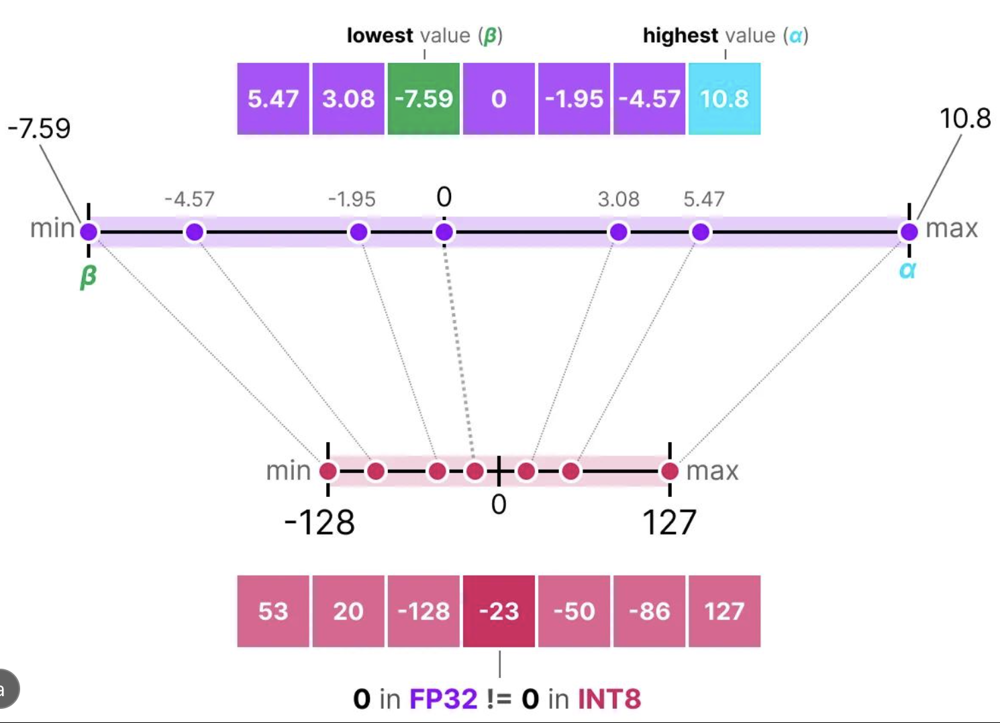

可以把量化理解成：

- 原始 FP32/FP16 数据：数值连续，可以表示非常多的不同数值。
- INT8 数据：只能表示 256 种整数。
- Scale：控制整数刻度对应多大的浮点数间隔。
- Zero Point：控制整数空间中的哪个位置对应浮点数 0。

因此，量化本质上是一种有损压缩。

# **3. Symmetric Quantization 和 Asymmetric Quantization**

实际量化中，通常有两种常见方式。

## **3.1 Symmetric Quantization（对称量化）**

对称量化的特点是：

\\[ z=0 \\]

Scale 通常根据绝对值最大值计算：

\\[ s=\frac{\max(|x|)}{127} \\]

对于 INT8：

\\[ q=round(x/s) \\]

例如：

```
x = [-1.0, -0.5, 0.0, 0.5, 1.0]
```

假设 Scale = 1/127：

```
q = [-127, -64, 0, 64, 127]
```

特点：

- 计算简单。
- 不需要 Zero Point。
- 非常适合 GPU 上的高性能计算。
- 常用于 Weight Quantization。

## **3.2 Asymmetric Quantization（非对称量化）**

非对称量化允许：

\\[ z \neq 0 \\]

通常根据数据的最小值和最大值计算：

\\[ s=\frac{x\_{\max}-x\_{\min}}{q\_{\max}-q\_{\min}} \\]

\\[ z=round\left(q\_{\min}-\frac{x\_{\min}}{s}\right) \\]

这样可以更好地利用整数表示范围，特别适合分布不对称的数据。

例如，数据集中在：

\\[ [0, 2] \\]

那么使用非对称量化，就可以更充分地利用 INT8 的表示范围。

| 对比         | Symmetric | Asymmetric        |
| ---------- | --------- | ----------------- |
| Zero Point | 通常为 0     | 可以不为 0            |
| 计算复杂度      | 较低        | 较高                |
| 数据分布       | 更适合对称分布   | 更适合非对称分布          |
| GPU Kernel | 通常更容易优化   | 需要额外处理 Zero Point |

# **4. 大模型中常见的量化粒度（Granularity）**

这是理解大模型量化非常重要的一个概念。

量化不仅要决定使用多少 bits，还需要决定：

**Scale 是针对多大的数据范围计算的？**

常见的粒度有以下几种。

## **4.1 Per-Tensor Quantization**

整个 Tensor 共享一个 Scale。

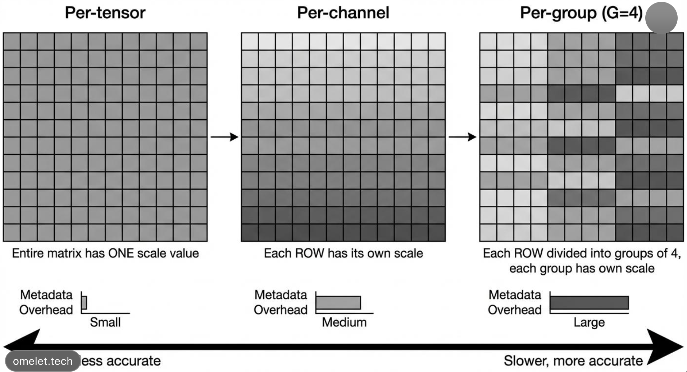

例如：

```
weights.shape = [4096, 4096]
```

整个矩阵只使用一个 Scale。

优点：实现简单，额外开销小。

缺点：如果不同区域的数据分布差异很大，一个 Scale 很难同时适应所有数据。

## **4.2 Per-Channel Quantization**

每个 Channel 使用一个独立的 Scale。

例如：

```
weights.shape = [4096, 4096]
```

如果按照 Output Channel 量化，那么每一行有一个 Scale：

```
scales.shape = [4096]
```

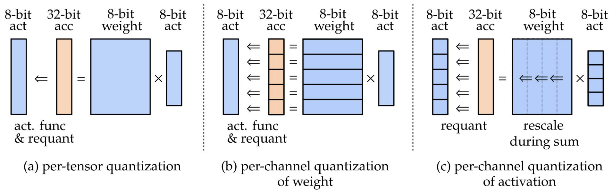

优点：比 Per-Tensor 更精确，额外 Scale 开销也比较小。

## **4.3 Per-Group Quantization**

将权重矩阵划分为多个 Group，每个 Group 使用独立的 Scale。

例如：

```
weights.shape = [4096, 4096]group_size = 128
```

每行被划分成：

\\[ 4096/128=32 \\]

个 Group。

因此：

```
scales.shape = [4096, 32]
```

[LLM軽量化・最適化技術の完全ガイド：量子化からMoEまで徹底解説｜アイドリ | AI-Driven Lab](https://images.openai.com/static-rsc-4/BtHaW0Hd4_kgknum3qvqwsBNoLDbPfookV2iUplziUxHdKBKVblCSG82Nf99HRgl4I1vG_tUuFcG9pi-_0qOXUnkdx0bK_A7xVlU7psd2TyFdV2KjykzvSDRiJgrGxmuRiQVjqqAwHEx_FuGl4kg4_glcqBkfz6KawO7oDLqyj4?purpose=inline)

[note.com](https://note.com/ai_driven/n/nd232c033b3f3?utm_source=chatgpt.com)

这种方式在大模型 INT4 量化中非常常见。

例如 AWQ、GPTQ 等方法都涉及 Group-wise Quantization。

三种粒度对比：

| 粒度          | Scale 数量      | 量化精度 | 额外开销 |
| ----------- | ------------- | ---- | ---- |
| Per-Tensor  | 1             | 较低   | 最低   |
| Per-Channel | 每个 Channel 一个 | 较高   | 低    |
| Per-Group   | 每个 Group 一个   | 通常更高 | 较高   |

# **5. 大模型推理中常见的量化方案**

实际工程中，你可能经常遇到下面这些名称。

FP8

# **8-bit**

**FP8 Quantization**

使用 8-bit 浮点数表示数据，常见格式包括 E4M3 和 E5M2。

- E4M3：4-bit exponent、3-bit mantissa，精度相对较高。
- E5M2：5-bit exponent、2-bit mantissa，动态范围更大。

常用于权重和激活量化，特别适合支持 FP8 的 GPU。

INT8

# **8-bit**

**INT8 Quantization**

使用 8-bit 整数表示数据。

- 权重和激活都可以量化。
- 通常需要 Scale，非对称量化还需要 Zero Point。
- GPU 可以通过整数矩阵乘法单元加速计算。

INT4

# **4-bit**

**INT4 Quantization**

每个参数只占用 4 bits。

- 显存占用是 FP16 的 1/4。
- 常用于 Weight-only Quantization。
- 通常需要 Group-wise Scale。
- Kernel 需要处理低比特数据的解包（Unpacking）和反量化。

FP4

# **4-bit**

**FP4 Quantization**

使用 4-bit 浮点数表示数据，例如 NVFP4。

- 相比 INT4，具有不同的数值表示和动态范围特性。
- 需要配合 Scale 等机制。
- 适用于支持低精度浮点计算的硬件。

这里需要特别注意：

**FP8 和 INT8 虽然都是 8 bits，但它们的数值表示方式完全不同。**

INT8 使用整数表示，需要 Scale 映射到浮点数范围；FP8 则直接使用浮点数格式中的 Sign、Exponent 和 Mantissa。

# **6. Weight-only Quantization 和 W8A8**

大模型推理中，还有一个非常重要的分类方式：究竟对哪些数据进行量化？

## **6.1 Weight-only Quantization**

只量化模型权重，Activation 仍然使用 FP16/BF16。

例如：

```
Weights:     INT4
Activations: FP16
Accumulate:  FP16 / FP32
```

计算过程大致是：

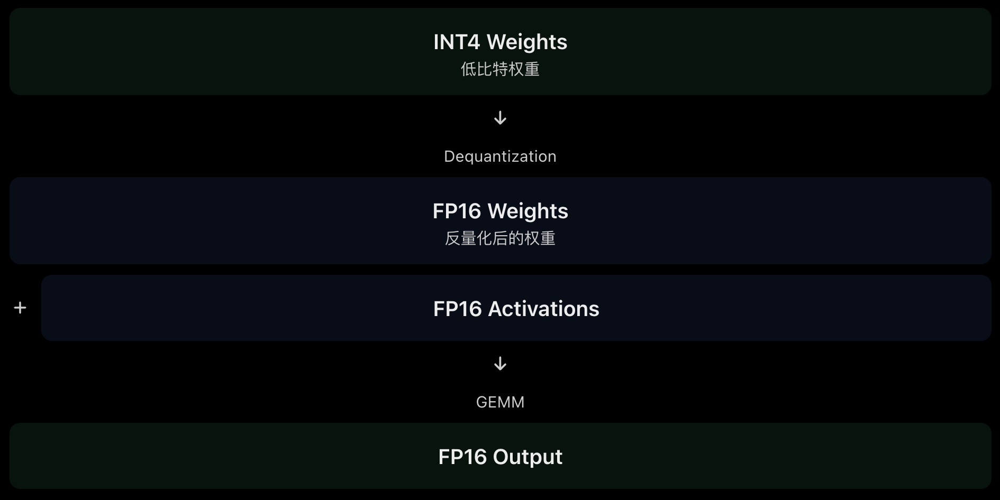

这里的反量化可以在 GEMM 计算过程中融合完成，不一定需要先生成一份完整的 FP16 权重矩阵。

这种方案的优势是：

- 权重读取量大幅减少。
- 不需要对 Activation 做量化。
- 通常比较容易保持模型精度。

## **6.2 W8A8 Quantization**

W8A8 表示：

- W8：Weights 使用 8-bit。
- A8：Activations 使用 8-bit。

计算流程：

```
FP16 Weights      -> INT8 Weights
FP16 Activations  -> INT8 Activations

INT8 GEMM

INT32 Accumulation
        |
        v
Rescale / Dequantization
        |
        v
FP16 Output
```

INT8 GEMM 的计算过程可以表示为：

\\[ Y\_{int32}=A\_{int8}\times B\_{int8} \\]

然后根据两个 Scale 恢复数值：

\\[ Y\_{fp16}\approx s_A s_B Y\_{int32} \\]

如果使用非对称量化，还需要考虑 Zero Point 修正。

W8A8 的优点是可以利用硬件的 INT8 矩阵乘法能力，同时减少权重和激活的存储、传输开销。

# **7. 从 GPU Kernel 的角度理解量化**

这部分与你研究 GPU Kernel 性能优化的关系比较大。

假设我们需要执行一个 GEMM：

\\[ C=A\times B \\]

其中：

\\[ A\in R^{M\times K},\quad B\in R^{K\times N} \\]

使用 FP16 时：

```
Load A (FP16)
Load B (FP16)
       |
       v
   FP16 GEMM
       |
       v
   FP16 C
```

如果使用 INT4 Weight-only Quantization：

```
Load A (FP16)
Load B (INT4)
       |
       v
Unpack INT4
       |
       v
Dequantize B
       |
       v
FP16 / Mixed Precision GEMM
       |
       v
   FP16 C
```

实际 Kernel 优化时，需要重点关注以下几个问题：

| 优化点                | 需要考虑的问题                              |
| ------------------ | ------------------------------------ |
| Memory Bandwidth   | INT4 是否有效减少 HBM 读取量？                 |
| Unpacking          | INT4 数据解包是否带来额外开销？                   |
| Dequantization     | Scale 应该在哪里应用？                       |
| Register Usage     | 解包和反量化是否增加寄存器压力？                     |
| Compute Throughput | 是否使用了 GPU 的专用矩阵计算单元？                 |
| Memory Coalescing  | 低比特数据的读取是否连续、高效？                     |
| Tiling             | 如何设计 Tile 来融合 Dequantization 和 GEMM？ |

尤其需要注意：

**量化不一定意味着 Kernel 性能一定更好。**

例如 INT4 可以将权重读取量降低到 FP16 的 1/4，但如果：

- INT4 Unpacking 开销很大；
- Dequantization 增加了大量指令；
- 寄存器压力过大导致 Register Spilling；
- GEMM 没有利用硬件专用矩阵计算单元；

最终 Kernel 可能并没有获得预期的性能提升。

因此，量化 Kernel 的优化本质上仍然需要结合 Roofline Model 分析 Memory-bound 和 Compute-bound 两种情况。

# **8. 最后总结：建立一个完整的知识框架**

可以从下面几个维度理解大模型量化：

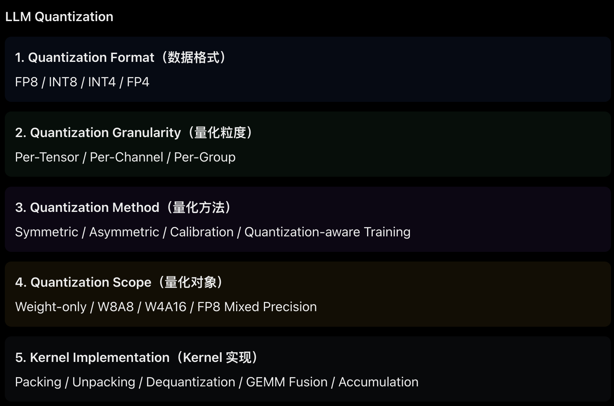

**我建议接下来重点学习三个方向：**

1. **AWQ 和 GPTQ**：理解 INT4 Group-wise Weight Quantization 的原理，以及两者如何降低量化误差。
2. **FP8 / NVFP4**：理解现代 GPU 上低精度浮点格式、Scale 设计以及硬件支持。
3. **Quantized GEMM Kernel**：理解 INT4/FP8 数据如何在 GPU 上进行高效加载、反量化和矩阵乘法融合。

这三个方向能够把量化的数学原理、模型推理优化和 GPU Kernel 性能优化串联起来。

---

在大模型推理和 GPU 低精度计算（FP8、FP4、INT4）中，**Block Scale（块级缩放）是指将 Tensor 划分成多个 Block，每个 Block 使用独立的 Scale 来进行量化和反量化。**

它本质上属于一种 **Group-wise Quantization（分组量化）**，只不过这里通常使用 Block 来描述分组。

它要解决的核心问题是：

> 不同区域的数据数值范围可能差异很大，如果整个 Tensor 只使用一个 Scale，会导致部分数据的量化精度较差。

## **1. 为什么需要 Block Scale？**

假设有一个包含 16 个元素的 Tensor：

```
x = [    0.1, 0.2, 0.3, 0.4,    10,  20,  30,  40,    0.01, 0.02, 0.03, 0.04,    100, 200, 300, 400]
```

可以看到，这些数据实际上分成了四组，每组的数值范围差异很大。

如果整个 Tensor 使用同一个 Scale：

\\[ s=\frac{\max(|x|)}{127}=\frac{400}{127} \\]

那么对于第一组数据：

\\[ 0.1/s \approx 0.032 \\]

量化后：

\\[ round(0.032)=0 \\]

也就是说，0.1 经过量化后变成了 0。

这显然会造成比较大的精度损失。

**Block Scale 的解决方案是：每个 Block 单独计算 Scale。**

## **2. Block Scale 是如何工作的？**

假设将上面的 Tensor 划分成 4 个 Block，每个 Block 包含 4 个元素。

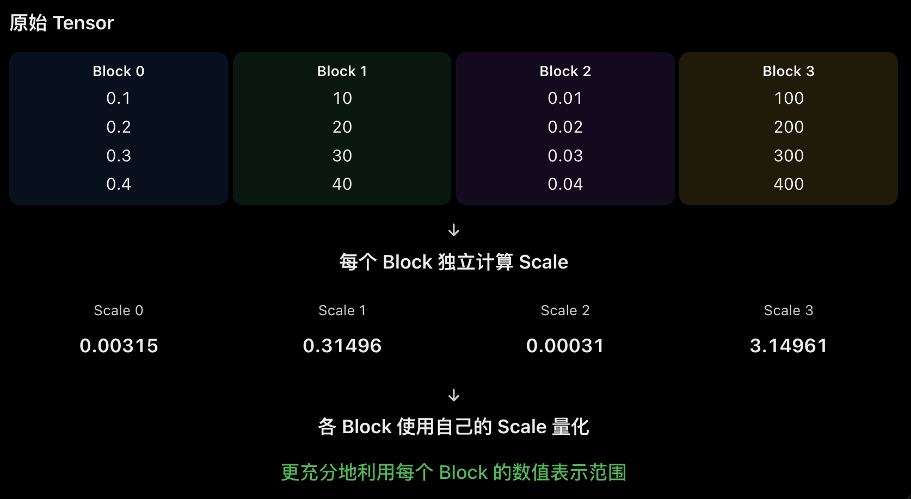

对于每个 Block，分别执行：

\\[ s_i=\frac{\max(|x_i|)}{127} \\]

\\[ q_i=round(x_i/s_i) \\]

这样，第一组数据就不再受到第四组数据的数值范围影响。

## **3. Block Scale 和 Per-Tensor / Per-Channel / Per-Group 的区别**

它们主要区别在于 Scale 的作用范围。

| 量化方式        | Scale 的作用范围         |
| ----------- | ------------------- |
| Per-Tensor  | 整个 Tensor 一个 Scale  |
| Per-Channel | 每个 Channel 一个 Scale |
| Per-Group   | 每个 Group 一个 Scale   |
| Block Scale | 每个 Block 一个 Scale   |

注意：Per-Group 和 Block Scale 在很多实现中本质上是相同的思想，只是具体分组维度、Block 形状和命名可能不同。

## **4. 在 FP8 / FP4 量化中，Block Scale 尤其重要**

你可能会在 NVIDIA GPU 的量化方案中经常看到 Block Scaling。

例如：

- FP8 Block Scaling
- MXFP8
- MXFP4
- NVFP4

这里需要区分两个概念：

**普通 Block Scaling：**

每个 Block 使用一个独立的 Scale。

**MX（Microscaling）格式：**

采用标准化的微缩放格式，例如 MXFP4 通常使用 E8M0 格式的共享 Scale，按照固定大小的元素块进行缩放（常见为每 32 个元素共享一个 Scale）。

例如 MXFP4：

```
Block 0: [x0, x1, ..., x31]  -> Scale 0
Block 1: [x32, ..., x63]     -> Scale 1
Block 2: [x64, ..., x95]     -> Scale 2
...
```

每个 Block 内部的元素使用 FP4 表示，而 Scale 负责调整整个 Block 的数值范围。

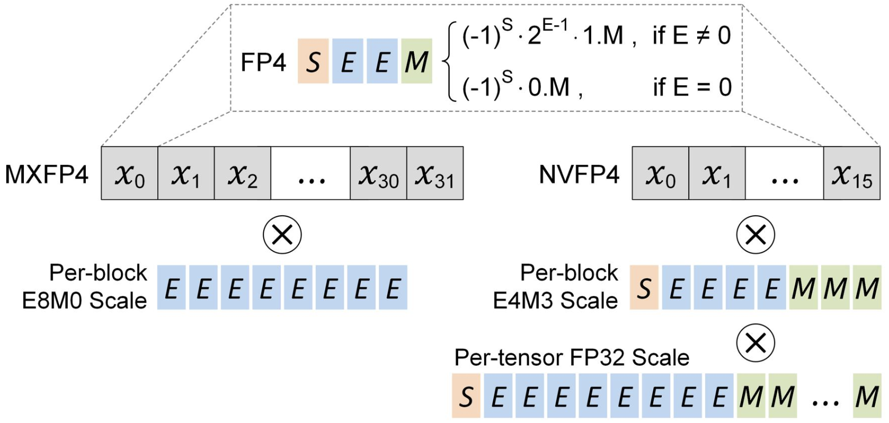

## **5. 从 GPU Kernel 优化角度，需要关注什么？**

Block Scale 不仅影响量化精度，也直接影响 Kernel 的实现和性能。

| 关注点            | 具体问题                                                 |
| -------------- | ---------------------------------------------------- |
| Block Size     | 一个 Block 包含 16、32、64 还是 128 个元素？                     |
| Scale Loading  | 如何高效加载 Scale？                                        |
| Memory Access  | Scale 和 Quantized Data 如何进行 Coalesced Memory Access？ |
| Dequantization | 如何将 Scale 融合到 GEMM 中？                                |
| Tiling         | Block Size 是否与 GEMM Tile 对齐？                         |
| Register Usage | 保存和广播 Scale 是否增加寄存器压力？                               |

尤其值得注意的是：**Block Size 越小，通常量化精度越容易控制，但 Scale 的存储和读取开销越大；Block Size 越大，Scale 开销越小，但可能损失量化精度。**

**建议你进一步理解一个概念：Scale 的层级结构。**

在现代 GPU 低精度计算中，可能同时存在：

- Tensor-level Scale
- Block-level Scale
- Element-level Scale

理解它们的区别，对后续学习 NVIDIA NVFP4、AMD FP8 以及量化 GEMM Kernel 的实现非常有帮助。

---

在大模型推理（LLM Inference）中，**动态量化（Dynamic Quantization）和静态量化（Static Quantization）的核心区别在于：量化时使用的 Scale 是提前确定的，还是在推理过程中根据实际输入数据动态计算的。**

简单来说：

- **静态量化（Static Quantization）**：提前通过 Calibration（校准）数据确定 Scale，推理时直接使用。
- **动态量化（Dynamic Quantization）**：推理时根据当前输入 Tensor 的实际数值分布，动态计算 Scale。

下面具体解释。

# **1. 静态量化（Static Quantization）**

静态量化的核心是：在模型部署之前，提前确定量化参数（Scale 和 Zero Point）。

通常需要经过两个阶段：

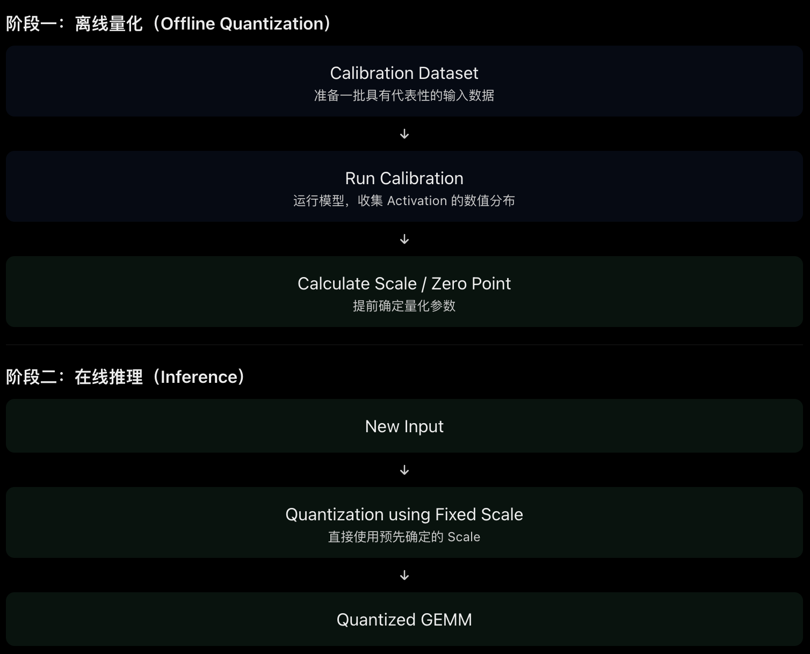

例如：

假设通过 Calibration 得到：

\\[ x\_{\max}=2.0,\quad x\_{\min}=-2.0 \\]

对于对称 INT8 量化：

\\[ s=\frac{2.0}{127} \\]

这个 Scale 在模型部署时就已经确定。

后续无论输入数据是什么，都使用这个 Scale。

**优点：**

- 推理时不需要动态计算 Scale。
- 减少运行时的额外计算开销。
- 更容易使用高性能 INT8 GEMM Kernel。
- 适合输入分布相对稳定的模型。

**缺点：**

如果实际推理输入的数据分布与 Calibration Dataset 差异很大，就可能出现：

1. 数据超出预先设定的量化范围，发生 Clipping。
2. 数据集中在很小的范围内，INT8 的表示精度没有充分利用。

# **2. 动态量化（Dynamic Quantization）**

动态量化则不同。

它不提前固定 Activation 的 Scale，而是在推理过程中，根据当前输入 Tensor 的实际数据分布计算 Scale。

例如：

第一次推理：

\\[ X_1=[-1.0,-0.5,0.5,1.0] \\]

计算：

\\[ s_1=\frac{\max(|X_1|)}{127}=\frac{1}{127} \\]

第二次推理：

\\[ X_2=[-4.0,-2.0,2.0,4.0] \\]

重新计算：

\\[ s_2=\frac{\max(|X_2|)}{127}=\frac{4}{127} \\]

可以看到：

\\[ s_1 \neq s_2 \\]

每次推理都会根据实际数据分布确定 Scale。

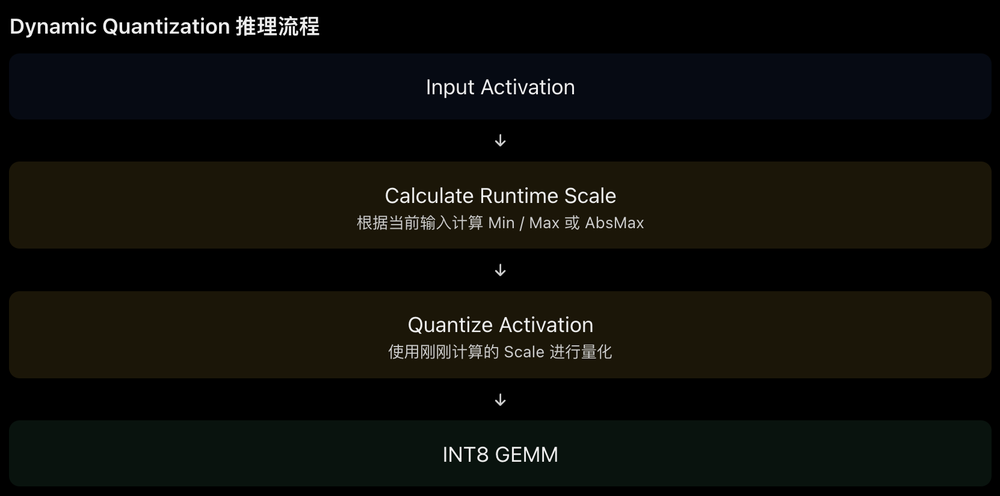

**优点：**

- 能够适应不同输入的数据分布。
- 不需要依赖 Calibration Dataset 来确定 Activation Scale。
- 能够降低因输入分布变化而产生的量化误差。

**缺点：**

- 每次推理都需要额外计算 Scale。
- 需要额外的 Reduction 操作，例如计算 AbsMax。
- 可能增加 Kernel Launch 和数据同步开销。
- 对小 Batch、低延迟场景，额外开销可能比较明显。

# **3. 动态量化 vs 静态量化**

总结一下：

| 对比维度             | 静态量化              | 动态量化                       |
| ---------------- | ----------------- | -------------------------- |
| Scale 确定时间       | 模型部署前             | 推理过程中                      |
| 是否需要 Calibration | 通常需要              | 不需要用于确定动态 Activation Scale |
| Scale 是否变化       | 通常固定              | 随输入变化                      |
| 推理额外开销           | 较低                | 较高                         |
| 对输入分布变化的适应性      | 较弱                | 较强                         |
| 实现复杂度            | Calibration 流程较复杂 | Runtime 计算较复杂              |

# **4. 在大模型推理中，Weight 和 Activation 的情况有什么不同？**

这是一个很值得注意的地方。

在 LLM 中，Weight 和 Activation 的量化策略经常是不一样的。

| 数据类型       | 静态量化 | 动态量化 |
| ---------- | ---- | ---- |
| Weight     | 常见   | 相对少见 |
| Activation | 常见   | 非常常见 |

为什么？

**Weight：**

模型加载后，Weight 通常不会发生变化。

因此，可以提前计算 Weight 的 Scale，完成量化并保存下来。

例如：

```
FP16 Weight
    |
Offline Quantization
    |
INT4 / INT8 Weight + Scale
    |
Save to Model Checkpoint
```

推理时直接加载量化后的 Weight 即可。

**Activation：**

Activation 是模型每次推理过程中动态产生的。

不同输入、不同 Token、不同 Layer，Activation 的数值分布都可能不同。

因此，很多量化方案会采用 Dynamic Activation Quantization。

例如：

```
Input Activation (FP16)
       |
Calculate AbsMax
       |
Calculate Scale
       |
Quantize to INT8
       |
INT8 GEMM
```

这也是为什么在大模型推理优化中，经常会看到 **Static Weight + Dynamic Activation** 这种组合。

# **5. 结合你可能接触的 FP8 / INT4 Kernel，再理解一个重要概念**

这里还有一个容易混淆的地方：

**Dynamic Quantization 和 Block-wise Quantization 是两个不同维度的概念。**

- Dynamic / Static：描述 Scale 什么时候确定。
- Per-Tensor / Per-Channel / Per-Group / Block-wise：描述 Scale 应用于多大范围的数据。

它们可以组合使用。

例如：

| 组合                 | 含义                     |
| ------------------ | ---------------------- |
| Static Per-Tensor  | 提前确定整个 Tensor 的 Scale  |
| Dynamic Per-Tensor | 推理时计算整个 Tensor 的 Scale |
| Static Per-Channel | 提前为每个 Channel 确定 Scale |
| Dynamic Per-Token  | 推理时为每个 Token 计算 Scale  |
| Dynamic Block-wise | 推理时为每个 Block 计算 Scale  |

特别是 **Dynamic Per-Token Quantization**，在大模型推理中很常见。

例如 Activation 的形状为：

\\[ X\in R^{M\times K} \\]

可以为每一行（一个 Token）计算一个独立的 Scale：

\\[ s_i=\frac{\max_j|X\_{i,j}|}{127} \\]

然后分别量化每一行。

这样不同 Token 就不需要共享同一个 Scale。

**我的建议：** 如果你接下来要研究 vLLM、Triton 或 ROCm 上的量化 GEMM Kernel，建议重点理解 Dynamic Per-Token Quantization 和 Block-wise Quantization。尤其要关注 `AbsMax Reduction → Scale Calculation → Quantization → GEMM` 这几个步骤能否融合，以及 Reduction 带来的额外开销。这些会直接影响量化 Kernel 的实际性能。

---

**为什么可以通过 GEMM 吸收量化操作来实现算子融合？**

这是一个非常好的问题。理解这个问题，你就能把\*\*量化的数学原理、GEMM 的计算过程和 GPU Kernel Fusion（算子融合）\*\*联系起来。

先说结论：

**之所以可以通过 GEMM 吸收（Absorb）量化操作，是因为量化中的 Scale、反量化以及矩阵乘法之间存在数学上的等价变换。我们可以把原本独立的 Quantization、Dequantization 操作，变成 GEMM 内部的一部分计算，从而避免额外的 Kernel Launch 和中间 Tensor 的读写。**

下面一步步推导。

# **1. 先看没有融合时的计算流程**

假设我们要计算一个矩阵乘法：

\\[ Y=XW \\]

其中：

- \\(X\\)：Activation，形状为 \\(M\times K\\)。
- \\(W\\)：Weight，形状为 \\(K\times N\\)。
- \\(Y\\)：Output，形状为 \\(M\times N\\)。

假设使用 INT8 Weight-only Quantization。

原始权重：

\\[ W\in FP16 \\]

量化之后：

\\[ Q_W=round(W/s_W) \\]

如果采用对称量化，那么反量化为：

\\[ \hat W=s_W Q_W \\]

因此，原来的矩阵乘法变成：

\\[ Y=X(s_W Q_W) \\]

如果不做算子融合，可能会经历以下流程：

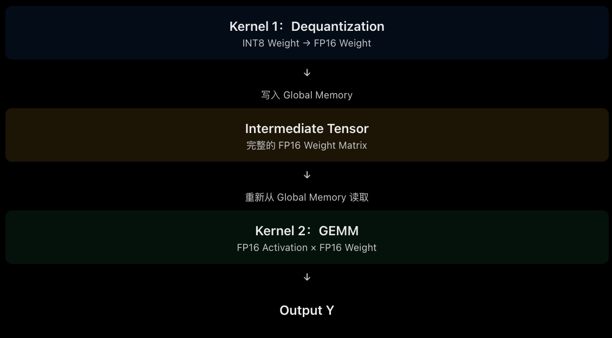

这里有两个明显的问题：

1. Dequantization 需要单独启动一个 Kernel。
2. Dequantization 生成的 FP16 Weight 需要写入 HBM，GEMM 又需要从 HBM 读取。

实际上，这些额外的数据搬运是可以避免的。

# **2. 数学推导：为什么可以把 Dequantization 放进 GEMM？**

回到：

\\[ Y=X(s_W Q_W) \\]

由于矩阵乘法满足数乘分配律：

\\[ Y=s_W(XQ_W) \\]

也就是说，我们可以：

1. 直接使用 INT8 Weight 参与计算。
2. 得到矩阵乘法结果。
3. 最后再乘以 Scale。

于是：

\\[ \boxed{Y=s_W\cdot(XQ_W)} \\]

这样就不需要先把整个 INT8 Weight Matrix 反量化成 FP16。

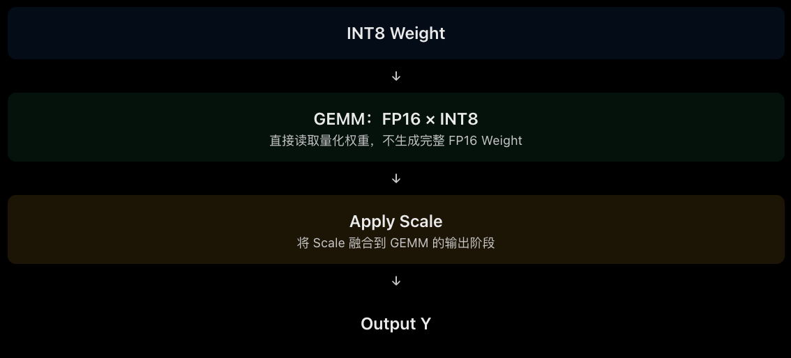

这里的 Apply Scale 可以直接融合进 GEMM 的 Epilogue（尾处理阶段）。

例如 GEMM 本身就需要将 Accumulator 转换成 FP16 Output，那么可以在转换时直接乘以 Scale。

不需要额外启动一个 Elementwise Multiplication Kernel。

# **3. 更重要：如果是 W8A8，Scale 如何吸收到 GEMM？**

上面是 Weight-only Quantization。

我们再考虑 W8A8，即 Activation 和 Weight 都使用 INT8。

原始计算：

\\[ Y=XW \\]

分别量化：

\\[ X\approx s_X Q_X \\]

\\[ W\approx s_W Q_W \\]

代入原始公式：

\\[ Y\approx(s_X Q_X)(s_W Q_W) \\]

由于 Scale 是标量：

\\[ \boxed{Y\approx s_Xs_W(Q_XQ_W)} \\]

这就意味着：

- INT8 Activation 和 INT8 Weight 可以直接进行 INT8 GEMM。
- GEMM 内部使用 INT32 Accumulator。
- 最后将结果乘以 \\(s_Xs_W\\)。

计算流程：

```
X (FP16)                 W (FP16)
    |                        |
 Quantize                  Quantize
    |                        |
 Q_X (INT8)               Q_W (INT8)
    |                        |
    +----------+-------------+
               |
               v
          INT8 GEMM
               |
               v
       INT32 Accumulator
               |
               v
       Apply Scale (sX * sW)
               |
               v
          FP16 Output
```

这就是为什么量化 GEMM 通常采用 INT8 输入、INT32 累加，然后再进行 Scale 和输出类型转换。

# **4. 如果使用 Block Scale，还能这样吸收吗？**

可以，但情况会复杂一些。

前面我们讨论过 Block Scale：不同 Block 有不同的 Scale。

假设 Weight 被划分为多个 Block：

\\[ W_j\approx s_jQ_j \\]

那么：

\\[ Y=XW \\]

展开：

\\[ Y=\sum_j X_jW_j \\]

代入量化表达式：

\\[ Y\approx\sum_j X_j(s_jQ_j) \\]

由于每个 Block 的 Scale 不一样：

\\[ \boxed{Y\approx\sum_j s_j(X_jQ_j)} \\]

注意这里有一个重要区别：

**如果所有数据共享一个 Scale，可以把 Scale 提取到整个 GEMM 的最后；如果每个 Block 有独立的 Scale，就不能简单地在整个 GEMM 结束后只乘一次 Scale。**

因为：

\\[ s_1(X_1Q_1)+s_2(X_2Q_2) \\]

通常不等于：

\\[ s(X_1Q_1+X_2Q_2) \\]

所以 Block Scale 必须在对应 Block 的部分结果上应用。

例如，将 K 维度分成 4 个 Block：

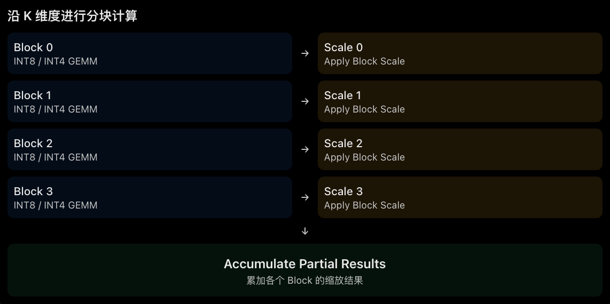

在实际 GPU Kernel 中，可以将 Block Scale 的应用融合到每个 K-Tile 的计算过程中，不需要单独启动 Dequantization Kernel。

这也是现代 FP8、FP4 Block-scaled GEMM Kernel 的一个重要优化方向。

# **5. 从 GPU 性能优化角度，算子融合到底节省了什么？**

这里可以联系之前讨论过的 Roofline Model、Memory Bandwidth 和 Kernel Launch Overhead。

假设：

- Weight 有 70B 个参数。
- 原始 Weight 使用 FP16。
- 量化 Weight 使用 INT8。

如果先反量化再 GEMM：

| 操作                    | 数据量    |
| --------------------- | ------ |
| 读取 INT8 Weight        | 70 GB  |
| 写入 FP16 Weight        | 140 GB |
| GEMM 重新读取 FP16 Weight | 140 GB |
| 合计                    | 350 GB |

如果直接使用 INT8 Weight 进行 GEMM：

| 操作             | 数据量   |
| -------------- | ----- |
| 读取 INT8 Weight | 70 GB |
| 合计             | 70 GB |

理论上减少约 80% 的上述权重数据搬运量

注意：这是忽略 Cache、Scale 和其他数据访问的简化估算，且假设两种方案都需要读取完整权重。

此外，还可以减少：

- 一次额外 Kernel Launch。
- 一次完整 FP16 Weight Tensor 的分配。
- 一次完整的 Dequantization 写入。
- GEMM 对中间 FP16 Tensor 的重新读取。

对于 Decode 阶段这种经常受 Weight Memory Bandwidth 限制的场景，这一点尤其重要。

# **6. 一个非常重要的边界：不是所有量化操作都能简单吸收到 GEMM 中**

例如 Dynamic Quantization：

\\[ s_X=\frac{\max(|X|)}{127} \\]

这里的 Scale 依赖当前 Activation。

因此，在执行 INT8 GEMM 之前，通常必须先完成：

1. 计算 Activation 的 AbsMax。
2. 根据 AbsMax 计算 Scale。
3. 将 Activation 量化成 INT8。

这些步骤不能简单地全部挪到 GEMM 之后。

但是，可以通过 Fusion 将它们融合到一个 GPU Kernel 中，例如在 GEMM 之前进行 Reduction 和 Quantization，或者使用专门设计的 Fused Quantization + GEMM Kernel。

具体能否融合，还取决于数据依赖、Tile 划分、硬件指令以及寄存器和共享内存资源。

## **7. 总结：理解 GEMM Fusion 的三个关键数学关系**

| 场景            | 数学关系                                  | Fusion 思路                                |
| ------------- | ------------------------------------- | ---------------------------------------- |
| Weight-only   | \\(X(s_WQ_W)=s_W(XQ_W)\\)             | Scale 放到 GEMM Epilogue                   |
| W8A8          | \\((s_XQ_X)(s_WQ_W)=s_Xs_W(Q_XQ_W)\\) | INT8 GEMM + INT32 Accumulation + Rescale |
| Block Scaling | \\(\sum_j s_j(X_jQ_j)\\)              | 每个 K-Block 独立应用 Scale，再累加                |

**我建议你下一步重点研究 GEMM 的 Epilogue Fusion 和 Block-scaled GEMM。**

前者帮助理解为什么 Bias、Scale、Activation Function 等操作可以融合到 GEMM；后者则是理解现代 NVIDIA FP8/NVFP4 和 AMD 低精度 GEMM Kernel 实现的关键。

---

